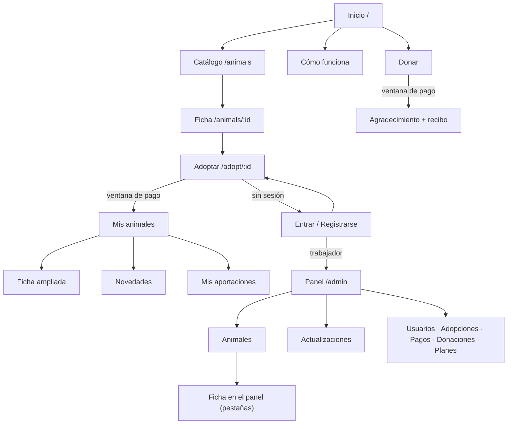

# Santuario de Animales — Pantallas

## 1. Cómo leer este documento

**Leyenda de los esquemas:**

| Símbolo | Significado |
| --- | --- |
| `[ Texto ]` | Botón (píldora). `[■ Texto]` = botón principal (terracota) |
| `( ) / (•)` | Opción sin marcar / marcada |
| `[☐] / [☑]` | Casilla |
| `‹ ›` | Flechas anterior / siguiente |
| `[____]` | Campo de texto |
| `▼` | Desplegable |
| `☰ ✕` | Iconos (Font Awesome en la aplicación). `✕` = cerrar |
| `ⓘ ⚠ ⓧ ✓` | Icono de aviso: información, advertencia, error, éxito |
| `╭─╮ ╰─╯` | Tarjeta (bordes redondeados, borde fino, sin sombra) |
| `┏━┓ ┗━┛` | Aviso en línea (borde del color del tipo) |

**Anchos de referencia:** «móvil» = 360–599 px; «escritorio» = 1024 px o más. La tablet (600–1023 px) es un paso intermedio: se indica solo cuando cambia algo importante. Puntos de corte en `DESIGN_SYSTEM.md` §7.

## 2. Estructura común

Hay tres plantillas (*layouts*) que envuelven a todas las pantallas:

| Plantilla | Pantallas | Cabecera | Navegación |
| --- | --- | --- | --- |
| `PublicLayout` | Web pública y autenticación | Pública | Enlaces en la cabecera; hamburguesa por debajo de 1024 px |
| `AdopterLayout` | Área del adoptante | Pública, con los enlaces del adoptante | Igual que la pública |
| `AdminLayout` | Panel de gestión | Del panel | Menú lateral; hamburguesa por debajo de 1024 px |

### 2.1 Cabecera pública

**Escritorio:**

```text
┌──────────────────────────────────────────────────────────────────────────────┐
│ Santuario de Animales    Animales  Cómo funciona  Donar  Sobre    [Entrar]│
└──────────────────────────────────────────────────────────────────────────────┘
```

**Móvil:**

```text
┌────────────────────────────────────┐
│ Santuario                ☰ │
└────────────────────────────────────┘
```

Contenido según quién navega:

| Usuario | Enlaces | Derecha |
| --- | --- | --- |
| Visitante | Animales · Cómo funciona · Donar · Sobre el santuario |  · [Entrar] · [■ Registrarse] (en escritorio) |
| Adoptante | Animales · Mis animales · Novedades (con contador de no leídas) · Donar | ·  · menú de usuario (nombre ▼): Mis aportaciones, Mi perfil, Cómo funciona, Cerrar sesión |
| Trabajador | Animales · Cómo funciona · Donar · **Panel** | ·  · menú de usuario: Mi perfil, Cerrar sesión |

**Menú de hamburguesa (móvil y tablet)** desplegado bajo la cabecera:

```text
┌────────────────────────────────────┐
│ Santuario                ✕ │
├────────────────────────────────────┤
│  Animales                          │
│  Mis animales                      │
│  Novedades                    (3)  │
│  Donar                             │
│  Cómo funciona                     │
│  Sobre el santuario                │
│  ────────────────────────────────  │
│  Mis aportaciones                  │
│  Mi perfil                         │
│  Cerrar sesión                     │
└────────────────────────────────────┘
```

Para el visitante, el final del menú son los botones [Entrar] y [■ Registrarse] a todo el ancho.

### 2.2 Aviso de página

Debajo de la cabecera, cuando procede (de tipo `warning` o `info`; no desaparecen solos):

- Email sin verificar (adoptante): «Verifica tu email para poder adoptar.» + [Reenviar email].
- Adopción pausada (adoptante): «No hemos podido cobrar la cuota de Lupe.» + [Pagar ahora].

### 2.3 Pie

```text
┌──────────────────────────────────────────────────────────────────────────────┐
│ Santuario de Animales          Animales        Contacto                     │
│ Un hogar para siempre para        Cómo funciona   Privacidad                   │
│ buitres que no pueden volver      Donar           Cookies                      │
│ a volar.                                                                       │
│ ─────────────────────────────────────────────────────────────────────────────  │
│ Proyecto académico · Los pagos son simulados                                   │
└──────────────────────────────────────────────────────────────────────────────┘
```

En móvil, las columnas se apilan. En el panel de gestión no hay pie.

### 2.4 Cookies

Al entrar por primera vez, un **aviso en línea** de tipo `info`, fijo en la parte inferior de la pantalla (no una ventana emergente, porque no bloquea nada): «Solo usamos cookies técnicas para mantener tu sesión. [Más información] [Entendido]». Se recuerda en el navegador.

## 3. Web pública

### 3.1 Inicio (`/`) — CU-01

**Escritorio:**

```text
[cabecera]
┌──────────────────────────────────────────────────────────────────────────────┐
│                                                                              │
│  Un hogar para siempre            ┌──────────────────────────────┐           │
│  para los buitres                 │                              │           │
│  ───                              │       FOTO DESTACADA         │           │
│  Cuidamos a buitres que no        │                              │           │
│  pueden volver a la naturaleza.   └──────────────────────────────┘           │
│                                                                              │
│  [■ Adopta a distancia]  [ Haz una donación ]   (oliva)                      │
│                                                                              │
├──────────────────────────────────────────────────────────────────────────────┤
│  12 animales acogidos      (cifra grande en Fraunces sobre banda beige)      │
├──────────────────────────────────────────────────────────────────────────────┤
│  Conoce a quienes viven aquí                                    Ver todos ›  │
│  ───                                                                         │
│  ╭────────╮ ╭────────╮ ╭────────╮ ╭────────╮                                 │
│  │ FOTO   │ │ FOTO   │ │ FOTO   │ │ FOTO   │   (AnimalCard × 4–6)            │
│  │ Brisa  │ │ Canelo │ │ Roca   │ │ Lupe   │                                 │
│  ╰────────╯ ╰────────╯ ╰────────╯ ╰────────╯                                 │
├──────────────────────────────────────────────────────────────────────────────┤
│  ¿Cómo funciona la adopción simbólica?                                       │
│  ① Elige un animal   ② Elige tu plan   ③ Recibe noticias cada dos semanas    │
│  [ Saber más ]                                                               │
└──────────────────────────────────────────────────────────────────────────────┘
[pie]
```

**Móvil:** todo en una columna, en este orden:

1. Título.
2. Foto destacada (4:3, todo el ancho).
3. Texto.
4. Los dos botones apilados a todo el ancho.
5. Contador.
6. Animales destacados en tarjetas de una columna (máximo 4, con [Ver todos los animales] debajo).
7. Los tres pasos, apilados con su icono.

### 3.2 Catálogo (`/animals`) — CU-02

**Escritorio:**

```text
[cabecera]
  Animales                                                      (h1)
  Todos ellos viven en el santuario y puedes adoptarlos a distancia.

  ┌──────────────────────────────────────────────────────────────────────────┐
  │ 🔍 [Buscar por nombre____]  Especie ▼  Sexo ▼  Edad ▼  [☐ Disponibles]   │
  │                                                    Ordenar: Recientes ▼  │
  └──────────────────────────────────────────────────────────────────────────┘
  Filtros activos: (Buitre negro ✕) (Disponibles ✕)   Limpiar filtros
  12 animales

  ╭──────────╮ ╭──────────╮ ╭──────────╮ ╭──────────╮
  │  FOTO    │ │  FOTO    │ │  FOTO    │ │  FOTO    │
  │ Rufo     │ │ Greta    │ │ Sombra   │ │ Ébano    │
  │ B. le…│ │ B. le…│ │ B. ne…│ │ B. ne…│
  │ 2     │ │ 2     │ │ 2     │ │ 1     │
  ╰──────────╯ ╰──────────╯ ╰──────────╯ ╰──────────╯
  … (cuadrícula de 3–4 columnas)

              [‹ Anterior]  1  (2)  3  [Siguiente ›]
[pie]
```

**Móvil:**

```text
  Animales
  Todos ellos viven en el santuario…

  🔍 [Buscar por nombre______]
  [ ⚙ Filtros (2) ]     Recientes ▼
  12 animales

  ╭──────────────────────────────╮
  │           FOTO 4:3           │
  │ Rufo                         │
  │ Buitre leonado · Macho    │
  │ 2 adoptantes              │
  ╰──────────────────────────────╯
  ╭──────────────────────────────╮
  │ …                            │

  [‹]   Página 2 de 3   [›]
```

- **Filtros en móvil:** el botón «Filtros» despliega un panel bajo él (no una ventana emergente) con los controles apilados y los botones [■ Ver 12 animales] y [Limpiar]. El número entre paréntesis indica los filtros activos.
- Los filtros se reflejan en la URL (`?speciesId=2&adoptable=true`), así el botón «Atrás» y los enlaces compartidos funcionan.
- **Sin resultados:** estado vacío «No hay animales con estos filtros» + [Limpiar filtros].
- **Cargando:** 8 tarjetas esqueleto.

### 3.3 Ficha del animal (`/animals/:id`) — CU-03

**Escritorio:**

```text
[cabecera]
  Animales › Rufo                                              (migas de pan)

  ┌────────────────────────────────┐   Rufo                            (h1)
  │                                │   Buitre leonado · Macho
  │        FOTO PRINCIPAL 4:3      │   nos 12 años · En el santuario desde 2021
  │                                │   [En tratamiento]   (insignia, si aplica)
  │                                │
  └────────────────────────────────┘   2 personas adoptan a Rufo
  [▪][▪][▪][▪]  (miniaturas)            Con el apoyo de Lucía
                                        ╭──────────────────────────────╮
                                        │ Adopción simbólica: Rufo     │
                                        │ seguirá viviendo aquí y      │
                                        │ recibirás noticias suyas     │
                                        │ cada dos semanas.            │
                                        │ Desde 1 € al mes.            │
                                        │ [■ ♥ Adoptar a Rufo]         │
                                        ╰──────────────────────────────╯

  Su historia                                                         (h2)
  Llegó tras electrocutarse en un tendido eléctrico… (máx. 70 caracteres por línea)

  Carácter                        Necesidades especiales
  Tranquilo y observador…         Posaderos bajos y rampas…

  Últimas noticias                                                    (h2)
  ╭──────────────────────────────────────────────╮
  │ 0 oct · Rufo estrena posadero            │
  │ Hemos instalado un posadero nuevo…  [Leer más]│
  ╰──────────────────────────────────────────────╯
[pie]
```

**Móvil**, en una columna:

1. Migas de pan.
2. Foto (desliza para ver las demás; contador «1/4»).
3. Nombre y datos.
4. Tarjeta «Adoptar».
5. Historia.
6. Carácter.
7. Necesidades.
8. Últimas noticias.

Además, una **barra inferior fija** con [■ ♥ Adoptar a Rufo] a todo el ancho, que aparece al pasar la tarjeta de adopción, para no tener que volver arriba.

- Variantes de la tarjeta «Adoptar» según CU-03: «Ya adoptas a Rufo» + [Ver su ficha completa]; «Ahora mismo no admite adopciones» (sin botón); trabajador: [Editar en el panel].
- Pulsar una foto abre el **visor** (ventana emergente con flechas).
- Sin adoptantes: «Todavía nadie ha adoptado a Rufo. ¿Quieres ser el primero?».

### 3.4 Cómo funciona (`/how-it-works`) — CU-04

Página de lectura, en una columna de 70 caracteres de ancho máximo:

1. Título y una introducción.
2. Aviso `info`: «Es una adopción simbólica: el animal sigue viviendo en el santuario».
3. Tres pasos con icono (elige, adopta, recibe noticias).
4. Los tres planes como tarjetas en fila (en columna en móvil), con nombre, importe al mes y descripción. La Usual lleva la insignia «La más habitual». Son informativas, no seleccionables.
5. Preguntas frecuentes en desplegables (`<details>`): ¿Puede tener varios adoptantes? ¿Puedo cambiar de plan? ¿Cómo me doy de baja? ¿Qué pasa si el animal fallece?
6. [■ Ver animales].

### 3.5 Donar (`/donate`) — CU-05

**Escritorio:** dos columnas. A la izquierda, un texto sobre a qué se destinan las donaciones; a la derecha, el formulario. **Móvil:** texto breve arriba y el formulario debajo.

```text
╭──────────────────────────────────────────╮
│ Haz una donación                    (h2) │
│                                          │
│ ¿Cuánto quieres donar?                   │
│ ( 5 € ) ( 10 € ) (•20 €) ( 50 € ) (Otra) │   ← píldoras seleccionables
│ [ 20,00 € ______ ]   Sin importe mínimo  │
│                                          │
│ Nombre (opcional)    [______________]    │
│ Email (opcional)     [______________]    │
│ Para enviarte el recibo.                 │
│ [☐] Quiero que mi donación sea anónima   │
│ Mensaje (opcional)                       │
│ [__________________________________]     │
│                                          │
│ [■ Continuar con el pago]                │
╰──────────────────────────────────────────╯
```

- Con sesión de adoptante, el nombre y el email aparecen rellenos.
- «Continuar» abre la **ventana de pago simulado** (`DESIGN_SYSTEM.md` §8.4).
- **Resultado correcto:** página de agradecimiento con aviso `success`, el recibo (tarjeta con concepto, importe, fecha y referencia) y [Imprimir recibo]. **Resultado fallido:** vuelta al formulario con aviso `error` «El pago no se ha completado» y los datos conservados.

### 3.6 Sobre el santuario y contacto (`/about`) — CU-06

Historia del santuario (texto con foto), ubicación (dirección en texto; sin mapas de servicios de terceros) y el formulario de contacto: nombre, email, asunto, mensaje y la casilla de privacidad. En escritorio, el texto y el formulario van en dos columnas; en móvil, apilados. Resultado con aviso en línea encima del formulario.

### 3.7 En memoria (`/memorial`) — CU-12 (Fase 3)

Introducción breve y respetuosa, y una cuadrícula de tarjetas como la del catálogo, sin contador de adoptantes y con las fechas «2022 – 2026». Tono sobrio: sin el separador decorativo caramelo ni botones de adopción.

### 3.8 Autenticación — CU-07 a CU-10

Todas las pantallas de autenticación comparten el mismo esquema: **una tarjeta centrada** de 440 px de ancho máximo (todo el ancho en móvil) sobre el fondo de la página.

```text
              ╭──────────────────────────────────╮
              │ Iniciar sesión              (h1) │
              │ ┏━━━━━━━━━━━━━━━━━━━━━━━━━━━━━━┓ │
              │ ┃ ⓧ Email o contraseña         ┃ │  ← aviso error (si hay)
              │ ┃   incorrectos.               ┃ │
              │ ┗━━━━━━━━━━━━━━━━━━━━━━━━━━━━━━┛ │
              │ Email                            │
              │ [______________________________] │
              │ Contraseña                  👁   │
              │ [______________________________] │
              │ ¿Has olvidado tu contraseña?     │
              │                                  │
              │ [■ Entrar]  (todo el ancho)      │
              │ ──────────────────────────────── │
              │ ¿No tienes cuenta? Regístrate    │
              ╰──────────────────────────────────╯
```

| Pantalla | Contenido |
| --- | --- |
| Registro (`/register`) | Nombre, apellidos, email, contraseña (con indicación «Mínimo 8 caracteres» y botón 👁 para mostrarla), repetir contraseña, casilla de privacidad con enlace, [■ Crear cuenta] |
| Iniciar sesión (`/login`) | Como el esquema |
| Verificar email (`/verify-email`) | Solo un aviso (éxito o error) y un botón: [Ir a Mis animales] o [Reenviar email] |
| He olvidado mi contraseña (`/forgot-password`) | Email y [■ Enviar enlace]; después, aviso `info` con el mensaje neutro |
| Nueva contraseña (`/reset-password`) | Nueva contraseña y repetirla, [■ Guardar contraseña]. También la usan los trabajadores invitados, con el título «Elige tu contraseña». |

## 4. Área del adoptante

Usa `AdopterLayout`: la misma cabecera y pie que la web pública, con los enlaces del adoptante.

### 4.1 Adoptar (`/adopt/:animalId`) — CU-13

Página propia (no ventana emergente) con un formulario corto. Al confirmar, se abre la ventana de pago simulado.

**Escritorio:**

```text
  Animales › Rufo › Adoptar

  Adoptar a Rufo                                                      (h1)
  ┏━━━━━━━━━━━━━━━━━━━━━━━━━━━━━━━━━━━━━━━━━━━━━━━━━━━━━━━━━━━━━━━━━━━━┓
  ┃ ⓘ Es una adopción simbólica: Rufo seguirá viviendo en el santuario  ┃
  ┃   y puede tener otros adoptantes. Recibirás noticias suyas cada     ┃
  ┃   dos semanas.                                                      ┃
  ┗━━━━━━━━━━━━━━━━━━━━━━━━━━━━━━━━━━━━━━━━━━━━━━━━━━━━━━━━━━━━━━━━━━━━┛

  Elige tu plan
  ╭───────────────╮ ┏━━━━━━━━━━━━━━━━┓ ╭───────────────╮
  │ ( ) Simbólica │ ┃ (•) Usual      ┃ │ ( ) Extraord. │   ← tarjetas seleccionables;
  │     1 €/mes   │ ┃     5 €/mes    ┃ │    12 €/mes   │     la elegida, borde terracota 2px
  │ Colabora con  │ ┃ La opción más  ┃ │ Cubre una     │     y fondo terracota suave
  │ lo mínimo.    │ ┃ habitual.      ┃ │ parte mayor…  │
  ╰───────────────╯ ┗━━━━━━━━━━━━━━━━┛ ╰───────────────╯
  Puedes cambiar de plan o darte de baja cuando quieras.

  ╭─────────────╮  Resumen
  │ FOTO Rufo   │  Rufo · Plan Usual
  ╰─────────────╯  5,00 € al mes. Primer cobro hoy.

  [ Volver ]                                      [■ Continuar con el pago]
```

**Móvil:** las tres tarjetas de plan se apilan (la Usual en medio, preseleccionada). Los botones van a todo el ancho, con la acción principal arriba.

- Los casos especiales (email sin verificar, ya lo adopta, trabajador) se muestran como aviso en línea en lugar del formulario (ver CU-13).
- **Pago correcto:** se va a «Mis animales» con aviso `success` «¡Ya adoptas a Rufo! Te hemos enviado un email de bienvenida».
- **Pago fallido:** se queda en esta página con aviso `error` y la opción de reintentar.

### 4.2 Mis animales (`/my-animals`) — CU-15

**Escritorio:**

```text
  Mis animales                                                       (h1)

  ╭──────────────────────────────────────────────────────────────────────────╮
  │ ╭─────────╮  Rufo                                  [Activa]              │
  │ │ FOTO    │  Buitre leonado                                              │
  │ │         │  Plan Usual · 5,00 €/mes · desde el 5 sep 2025               │
  │ ╰─────────╯  róxima noticia prevista: hacia el 24 nov                │
  │              [■ Ver su ficha]  [ Cambiar plan ]  [ Certificado ]  ⋯       │
  ╰──────────────────────────────────────────────────────────────────────────╯
  ╭──────────────────────────────────────────────────────────────────────────╮
  │ ╭─────────╮  Lupe                                  [Pausada]             │
  │ │ FOTO    │  ┏━━━━━━━━━━━━━━━━━━━━━━━━━━━━━━━━━━━━━━━━━━━━━━━━━━━━━━━┓   │
  │ ╰─────────╯  ┃ ⚠ No hemos podido cobrar la cuota del 25 oct.         ┃   │
  │              ┃   [■ Pagar ahora]                                     ┃   │
  │              ┗━━━━━━━━━━━━━━━━━━━━━━━━━━━━━━━━━━━━━━━━━━━━━━━━━━━━━━━┛   │
  ╰──────────────────────────────────────────────────────────────────────────╯

  Historial                                                   (desplegable)
  Faro · Finalizada el 21 oct · Faro nos dejó.  ¿Quieres continuar con otro animal?
```

**Móvil:** cada adopción es una tarjeta con la foto 4:3 arriba y los datos debajo. Las acciones secundarias van en un menú «⋯» (Cambiar plan, Certificado, Darme de baja); el botón principal va a todo el ancho.

- «Darme de baja» y «Cambiar plan» están en el menú «⋯» en escritorio también, para no saturar la tarjeta.
- **Darme de baja** abre una ventana de confirmación. **Cambiar plan** abre un desplegable en la tarjeta (no una ventana emergente) con las tres opciones y [■ Guardar].
- Con baja solicitada: aviso `info` «Activa hasta el 29 nov. No se te volverá a cobrar».
- Sin adopciones: estado vacío + [■ Ver animales].

### 4.3 Ficha ampliada (`/my-animals/:animalId`) — CU-16

La misma estructura que la ficha pública (3.3), con estos cambios:

- En lugar de la tarjeta «Adoptar», una tarjeta **«Tu adopción»**: plan, estado, fecha de inicio, próxima noticia prevista y los enlaces de gestión.
- La galería incluye las fotos y vídeos exclusivos, con la insignia «Solo adoptantes» en la miniatura.
- La sección **«Su salud»** muestra el resumen en lenguaje sencillo, en una tarjeta con el icono `stethoscope`.
- **«Noticias»** muestra todas las actualizaciones (no solo las públicas), con la insignia «Nuevo» en las no leídas.

### 4.4 Novedades (`/feed`) — CU-17

Una sola columna centrada (máximo 720 px), igual en móvil y en escritorio:

```text
  Novedades                                                          (h1)
  Mostrar: (•) Todas ( ) Sin leer        Animal: Todos ▼

  ╭────────────────────────────────────────────────────────╮
  │ ╭───╮ Greta · hace 1 día                     [Nuevo]   │
  │ ╰───╯                                                  │
  │ Greta y su baño de sol                       (h3)      │
  │ Con el buen tiempo, Greta pasa las mañanas con las     │
  │ alas abiertas al sol…                                  │
  │ ┌────────────────────────┐                             │
  │ │      FOTO 4:3          │                             │
  │ └────────────────────────┘                             │
  │                         [ Marcar como no leída ]       │
  ╰────────────────────────────────────────────────────────╯
  ╭────────────────────────────────────────────────────────╮
  │ …                                                      │
```

- Las actualizaciones no leídas tienen la insignia «Nuevo» y el borde de la tarjeta en terracota. Se marcan como leídas al verse en pantalla.
- Se cargan más al llegar al final, con un botón [Cargar más] (no carga infinita automática, para que se pueda llegar al pie).

### 4.5 Mis aportaciones (`/my-contributions`) — CU-19

- Arriba, tarjetas de resumen: «Aportado en 2026: 87,00 €» y «Desde que empezaste: 152,00 €».
- Pestañas **Cuotas** y **Donaciones**.
- En escritorio, una tabla (fecha, concepto, importe, estado, [Recibo]). En móvil, una lista de tarjetas compactas, como en el panel.
- Filtro por año.

### 4.6 Mi perfil (`/profile`) — CU-23, CU-24, CU-25

Una columna (máximo 560 px), con secciones separadas por títulos h2 y cada una con su propio botón de guardar y sus propios avisos:

1. **Tus datos:** nombre, apellidos, teléfono; el email solo se muestra. [■ Guardar cambios].
2. **Notificaciones:** interruptor «Recibir emails», opciones «Un email por cada novedad» / «Un resumen al mes». [■ Guardar].
3. **Privacidad:** interruptor «Mostrar mi nombre en la ficha de los animales que adopto», con un texto de ayuda que explica qué se verá.
4. **Contraseña:** actual, nueva, repetir. [■ Cambiar contraseña].
5. **Eliminar cuenta:** sección final con borde `--color-error` y explicación; el botón `outline` [Eliminar mi cuenta] abre la ventana de confirmación con contraseña.

Los trabajadores ven solo las secciones 1 y 4.

### 4.7 Notificaciones (`/notifications`) — CU-18

Lista completa paginada, con el mismo aspecto que el desplegable de la campana (`DESIGN_SYSTEM.md` §8.8): icono según el tipo, mensaje, fecha relativa («hace 2 días»), punto terracota si no está leída y botón de borrar. Arriba, [Marcar todas como leídas].

## 5. Panel de gestión

Usa `AdminLayout`: más sobrio y compacto (`DESIGN_SYSTEM.md` §8.10).

### 5.1 Estructura

**Escritorio:**

```text
┌────────────────┬─────────────────────────────────────────────────────────────┐
│ Santuario   │  Animales › Rufo                            Nuria ▼     │
│   Panel        ├─────────────────────────────────────────────────────────────┤
│                │                                                             │
│ ▌Escritorio    │                                                             │
│  ANIMALES      │                  CONTENIDO DE LA SECCIÓN                    │
│  Animales      │                                                             │
│  Actualizac.   │                                                             │
│  Especies      │                                                             │
│  Veterinario   │                                                             │
│  ADMINISTRAC.  │                                                             │
│  Usuarios      │                                                             │
│  Adopciones    │                                                             │
│  Pagos         │                                                             │
│  Donaciones    │                                                             │
│  Planes        │                                                             │
│  Estadísticas  │                                                             │
│  Actividad     │                                                             │
│ ────────────── │                                                             │
│  Ver la web ↗  │                                                             │
└────────────────┴─────────────────────────────────────────────────────────────┘
```

- La sección «Administración» solo aparece para el administrador.
- Las secciones de la Fase 3 (Veterinario, Estadísticas, Actividad) aparecen cuando estén implementadas.
- **Móvil y tablet:** el menú lateral se oculta. La cabecera muestra ☰ · «Panel» · · , y la hamburguesa despliega el mismo menú a todo el ancho.

### 5.2 Escritorio del panel (`/admin`) — CU-27

**Escritorio:**

```text
  Hola, Nuria                                                        (h1)

  ╭─────────────╮ ╭─────────────╮ ╭─────────────╮ ╭─────────────╮
  │ 15          │ │ 11          │ │ 2           │ │ 438,40 €    │   ← cifras en Fraunces
  │ animales    │ │ adopciones  │ │ pendientes  │ │ este mes    │   ← solo admin: ingresos
  │ 3 en trat.  │ │ activas     │ │ de pago ›   │ │ cuotas 91 € │
  ╰─────────────╯ ╰─────────────╯ ╰─────────────╯ │ donac. 347 €│
                                                  ╰─────────────╯
  Noticias pendientes                                                (h2)
  ┏━━━━━━━━━━━━━━━━━━━━━━━━━━━━━━━━━━━━━━━━━━━━━━━━━━━━━━━━━━━━━━━━━━━━━━━┓
  ┃ ⓧ Turia lleva 16 días sin actualización (1 adoptante)               ┃  ← error
  ┃                                      [■ Publicar actualización]    ┃
  ┗━━━━━━━━━━━━━━━━━━━━━━━━━━━━━━━━━━━━━━━━━━━━━━━━━━━━━━━━━━━━━━━━━━━━┛
  ┏━━━━━━━━━━━━━━━━━━━━━━━━━━━━━━━━━━━━━━━━━━━━━━━━━━━━━━━━━━━━━━━━━━━━━┓
  ┃ ⚠ A Ébano le quedan 2 días para cumplir 14 sin actualización        ┃  ← warning
  ┃                                      [■ Publicar actualización]    ┃
  ┗━━━━━━━━━━━━━━━━━━━━━━━━━━━━━━━━━━━━━━━━━━━━━━━━━━━━━━━━━━━━━━━━━━━━┛

  Accesos rápidos:  [ + Nuevo animal ]  [ + Nueva actualización ]
```

**Móvil:** tarjetas de resumen en dos columnas (una si no caben), seguidas de las alertas y los accesos rápidos a todo el ancho.

- Estas alertas son la excepción a la regla de que los avisos se pueden cerrar: **no** llevan ✕, porque desaparecen solas al publicar la actualización.
- Sin alertas: aviso `success` «Todos los animales con adoptantes están al día».

### 5.3 Listados del panel (patrón común)

Todos los módulos del panel (animales, actualizaciones, especies, usuarios, adopciones, pagos, donaciones, planes) siguen el **mismo patrón**:

**Escritorio:**

```text
  Animales                                              [■ + Nuevo animal]
  🔍 [Buscar_______]  Especie ▼  Estado ▼  Publicado ▼  Adoptable ▼
  15 resultados                                           [ ⬇ Exportar CSV ] (si aplica)

  ┌────────┬───────────┬────────────────┬──────────────┬──────────┬──────────┐
  │ Foto   │ Nombre ▲  │ Especie        │ Estado       │ Adoptan. │ Acciones │
  ├────────┼───────────┼────────────────┼──────────────┼──────────┼──────────┤
  │ [▪]    │ Rufo      │ Buitre leonado │ En santuario │        2 │  ✎   🗑  │
  │ [▪]    │ Pipa      │ Buitre leonado │ [Oculto][Tr.]│        0 │  ✎   🗑  │
  └────────┴───────────┴────────────────┴──────────────┴──────────┴──────────┘
                        [‹ Anterior]  1  2  [Siguiente ›]
```

**Móvil** (cada fila es una tarjeta):

```text
  Animales                         [■ +]
  🔍 [Buscar______]   [ ⚙ Filtros ]

  ╭──────────────────────────────────╮
  │ [▪] Rufo                         │
  │ Especie: Buitre leonado          │
  │ Estado: En santuario             │
  │ Adoptantes: 2                    │
  │                  [ ✎ Editar ] ⋯ │
  ╰──────────────────────────────────╯
```

- Pulsar una fila (o su tarjeta) abre el detalle o el formulario de edición.
- Las cabeceras de columna ordenables muestran ▲/▼ y tienen `aria-sort`.
- Las acciones destructivas siempre piden confirmación en una ventana emergente.

**Columnas de cada listado:**

| Listado | Columnas | Filtros | Acciones de fila |
| --- | --- | --- | --- |
| Animales | Foto, nombre, especie, estado, publicado, adoptable, adoptantes activos | Especie, estado, publicado, adoptable | Editar, borrar (admin) |
| Actualizaciones | Fecha, animal, título, visibilidad, autor | Animal, visibilidad, autor | Editar, borrar (autor o admin) |
| Especies | Nombre, nombre científico, nº de animales | — | Editar, borrar (admin) |
| Usuarios | Nombre, email, rol, estado, alta, último acceso | Rol, estado | Ver, activar/desactivar |
| Adopciones | Adoptante, animal, plan, estado, inicio, próximo cobro | Estado, plan, animal | Ver, pausar/reanudar, cancelar |
| Pagos | Fecha, adoptante, animal, periodo, importe, método, estado | Estado, método, fechas | Ver, devolver |
| Donaciones | Fecha, donante (o «Anónimo»), importe, método, estado | Estado, método, fechas | Ver, devolver |
| Planes | Nombre, importe, por defecto, activo, adopciones activas | — | Editar, desactivar |

En **Pagos** y **Donaciones**, encima de la tabla se muestra la suma de lo filtrado. En **Donaciones**, además, una pestaña «Por meses» con el total de cada mes.

### 5.4 Ficha de animal en el panel (`/admin/animals/:id`) — CU-28, CU-29, CU-33, CU-34

Encabezado con el nombre, las insignias de estado y las acciones [Ver en la web ↗] y [Cambiar estado ▼]. Debajo, **pestañas**:

| Pestaña | Contenido |
| --- | --- |
| **Datos** | Formulario: en escritorio, dos columnas (identificación a la izquierda: nombre, especie, raza, sexo, fechas; publicación a la derecha: interruptores «Publicado» y «Admite adopciones»); debajo, a todo el ancho, las áreas de texto (historia, carácter, necesidades, resumen de salud). En móvil, una columna. [■ Guardar cambios] fijo al pie de la pestaña. |
| **Fotos** | Zona de subida (arrastrar o [Elegir archivos]) y cuadrícula de miniaturas reordenables. Cada miniatura muestra la visibilidad, una estrella para la portada y los botones de editar y borrar. En móvil, el orden se cambia con los botones ↑ ↓ en lugar de arrastrar. |
| **Actualizaciones** | Lista de las actualizaciones del animal + [■ Nueva actualización] |
| **Veterinario** (Fase 3) | Tabla de registros + gráfico de peso + [■ Nuevo registro] |
| **Adoptantes** (admin) | Adopciones del animal con su estado |

**Cambiar estado → Fallecido o Trasladado** abre una ventana emergente (CU-33):

```text
╭────────────────────────────────────────────────╮
│ ¿Registrar el fallecimiento de Faro?       ✕  │
│                                                │
│ Se cerrará su adopción abierta (1) y           │
│ dejará de aparecer en el catálogo.             │
│                                                │
│ Fecha              [ 21/10/2026 ]              │
│ Mensaje para sus adoptantes                    │
│ [____________________________________]         │
│ [____________________________________]         │
│ Este texto lo leerán las personas que lo       │
│ adoptaban. Escríbelo con calma.                │
│ [☐] Mostrar en «En memoria»   (Fase 3)         │
│                                                │
│              [ Cancelar ]  [■ Registrar]       │
╰────────────────────────────────────────────────╯
```

El botón de confirmar es terracota, no rojo: no es un borrado, sino un cambio de estado delicado.

### 5.5 Nueva actualización (`/admin/updates/new`) — CU-31

Formulario de una columna (máximo 720 px):

1. Animal ▼, preseleccionado si se viene de su ficha o de una alerta.
2. Título.
3. Texto (área de texto grande).
4. Fotos y vídeos (misma zona de subida, con el texto alternativo de cada uno).
5. Visibilidad: (•) Solo adoptantes ( ) Pública.

Debajo, la línea informativa «Se avisará a 2 adoptantes» y [■ Publicar]. Tras publicar: aviso `success` «Actualización publicada. Hemos avisado a 2 adoptantes».

### 5.6 Otras pantallas del panel

| Pantalla | Descripción |
| --- | --- |
| Detalle de usuario | Tarjeta con datos y estado + pestañas «Adopciones» y «Aportaciones» (adoptantes) o «Actividad» (trabajadores, Fase 3). Acciones: activar/desactivar, cambiar rol (trabajadores), reenviar invitación. |
| Nuevo trabajador | Formulario corto: nombre, apellidos, email, teléfono, rol (cuidador/administrador). Tras crearlo: aviso `success` «Hemos enviado una invitación a…». |
| Detalle de adopción | Datos, notas internas, tabla de pagos y acciones (pausar, reanudar, cancelar), cada una con su ventana de confirmación y nota obligatoria |
| Nueva adopción manual | Adoptante (buscador), animal (solo adoptables), plan, método del primer pago, notas |
| Registro manual de pago o donación | Formulario corto con el método (efectivo o transferencia), el importe y la fecha |
| Planes | Lista de tres tarjetas editables en línea (nombre, importe, descripción, por defecto, activo). Al cambiar un importe con adopciones activas, aviso `warning` antes de guardar. |
| Estadísticas (Fase 3) | Selector de rango de fechas + gráficos en tarjetas (dos columnas en escritorio, una en móvil). Los colores de los gráficos salen de la paleta: terracota para cuotas, oliva para donaciones. |
| Registro de actividad (Fase 3) | Listado con el patrón común; filtros por usuario, tabla, acción y fechas |

## 6. Estados generales

| Estado | Cómo se muestra |
| --- | --- |
| **Cargando** | Esqueletos con la forma del contenido (tarjetas, filas de tabla, bloques de texto). En los botones, el estado «Cargando». Nunca una pantalla en blanco ni de carga a página completa. |
| **Vacío** | Icono + frase amable + acción, si la hay (ver `DESIGN_SYSTEM.md` §8.9) |
| **Error al cargar** | Aviso `error` en lugar del contenido: «No hemos podido cargar los animales» + [Reintentar] |
| **Página no encontrada (404)** | Página con la cabecera normal, icono `feather`, «Esta página ha volado lejos» y [■ Volver al inicio] [ Ver animales ] |
| **Sin permiso (403)** | Igual que la 404, con «No tienes acceso a esta página» y el enlace a la zona que sí le corresponde |
| **Sesión caducada** | Redirección a «Iniciar sesión» con aviso `info` «Tu sesión ha caducado. Vuelve a entrar» y vuelta a la página donde estaba |
| **Sin conexión** | Aviso `warning` de página: «Parece que no hay conexión. Algunos datos pueden no estar actualizados» |

## 7. Mapa de pantallas



| Pantalla | Ruta | Plantilla | Casos de uso | Fase |
| --- | --- | --- | --- | --- |
| Inicio | `/` | Pública | CU-01 | 1 |
| Catálogo | `/animals` | Pública | CU-02 | 1 |
| Ficha del animal | `/animals/:id` | Pública | CU-03 | 1 |
| Cómo funciona | `/how-it-works` | Pública | CU-04 | 1 |
| Donar y agradecimiento | `/donate` | Pública | CU-05 | 2 |
| Sobre el santuario y contacto | `/about` | Pública | CU-06 | 1 (contacto: 2) |
| En memoria | `/memorial` | Pública | CU-12 | 3 |
| Registro, entrar, verificar, recuperar contraseña | `/register`, `/login`, `/verify-email`, `/forgot-password`, `/reset-password` | Pública | CU-07 a CU-10 | 1 |
| Adoptar | `/adopt/:animalId` | Adoptante | CU-13, CU-14 | 1 |
| Mis animales | `/my-animals` | Adoptante | CU-15, CU-20, CU-21, CU-22 | 1 |
| Ficha ampliada | `/my-animals/:animalId` | Adoptante | CU-16 | 1 |
| Novedades | `/feed` | Adoptante | CU-17 | 1 |
| Mis aportaciones | `/my-contributions` | Adoptante | CU-19 | 2 |
| Mi perfil | `/profile` | Adoptante / pública | CU-23, CU-24, CU-25 | 1 |
| Notificaciones | `/notifications` | Adoptante / pública | CU-18 | 2 |
| Escritorio | `/admin` | Panel | CU-27 | 1 |
| Animales y ficha en el panel | `/admin/animals`, `/admin/animals/:id` | Panel | CU-28, CU-29, CU-33, CU-34 | 1 |
| Especies | `/admin/species` | Panel | CU-30 | 1 |
| Actualizaciones | `/admin/updates` | Panel | CU-31, CU-32 | 1 |
| Usuarios | `/admin/users` | Panel | CU-35, CU-36 | 2 |
| Adopciones | `/admin/adoptions` | Panel | CU-37 | 2 |
| Pagos | `/admin/payments` | Panel | CU-38 | 2 |
| Donaciones | `/admin/donations` | Panel | CU-39 | 2 |
| Planes | `/admin/plans` | Panel | CU-40 | 2 |
| Estadísticas | `/admin/stats` | Panel | CU-41 | 3 |
| Registro de actividad | `/admin/activity` | Panel | CU-42 | 3 |