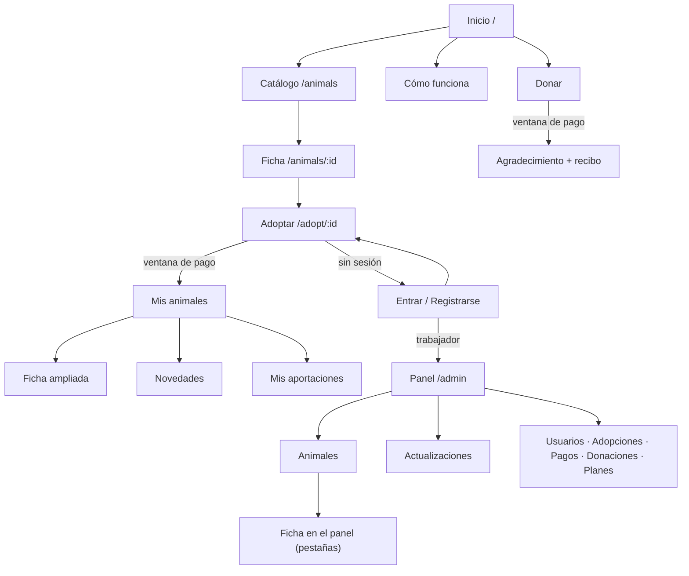

# Santuario de Animales — Pantallas

## 1. Cómo leer este documento

**Leyenda de los esquemas:**

| Símbolo | Significado |
| --- | --- |
| `[ Texto ]` | Botón (píldora). `[■ Texto]` = botón principal (terracota) |
| `( ) / (•)` | Opción sin marcar / marcada |
| `[☐] / [☑]` | Casilla |
| `‹ ›` | Flechas anterior / siguiente |
| `[____]` | Campo de texto |
| `▼` | Desplegable |
| `☰ ✕` | Iconos (Font Awesome en la aplicación). `✕` = cerrar |
| `ⓘ ⚠ ⓧ ✓` | Icono de aviso: información, advertencia, error, éxito |
| `╭─╮ ╰─╯` | Tarjeta (bordes redondeados, borde fino, sin sombra) |
| `┏━┓ ┗━┛` | Aviso en línea (borde del color del tipo) |

**Anchos de referencia:** «móvil» = 360–599 px; «escritorio» = 1024 px o más. La tablet (600–1023 px) es un paso intermedio: se indica solo cuando cambia algo importante. Puntos de corte en `DESIGN_SYSTEM.md` §7.

## 2. Estructura común

Hay tres plantillas (*layouts*) que envuelven a todas las pantallas:

| Plantilla | Pantallas | Cabecera | Navegación |
| --- | --- | --- | --- |
| `PublicLayout` | Web pública y autenticación | Pública | Enlaces en la cabecera; hamburguesa por debajo de 1024 px |
| `AdopterLayout` | Área del adoptante | Pública, con los enlaces del adoptante | Igual que la pública |
| `AdminLayout` | Panel de gestión | Del panel | Menú lateral; hamburguesa por debajo de 1024 px |

### 2.1 Cabecera pública

**Escritorio:**

```text
┌──────────────────────────────────────────────────────────────────────────────┐
│ Santuario de Animales    Animales  Cómo funciona  Donar  Sobre    [Entrar]│
└──────────────────────────────────────────────────────────────────────────────┘
```

**Móvil:**

```text
┌────────────────────────────────────┐
│ Santuario                ☰ │
└────────────────────────────────────┘
```

El selector de idioma (Fase 3, `DESIGN_SYSTEM.md` §8.7) cambia toda la interfaz al momento. Con sesión, guarda además el idioma en la cuenta, que se usa para los emails y los PDF; al entrar, la web pasa al idioma de la cuenta. Sin sesión, se recuerda en el navegador. Los contenidos escritos por el santuario (nombres, historias, actualizaciones, planes) no se traducen.

Contenido según quién navega:

| Usuario | Enlaces | Derecha |
| --- | --- | --- |
| Visitante | Animales · Cómo funciona · Donar · Sobre el santuario | Idioma ·  · [Entrar] · [■ Registrarse] (en escritorio) |
| Adoptante | Animales · Mis animales · Novedades (con contador de no leídas) · Donar | · Idioma ·  · menú de usuario (nombre ▼): Mis aportaciones, Mi perfil, Cómo funciona, Cerrar sesión |
| Trabajador | Animales · Cómo funciona · Donar · **Panel** | · Idioma ·  · menú de usuario: Mi perfil, Cerrar sesión |

**Menú de hamburguesa (móvil y tablet)** desplegado bajo la cabecera:

```text
┌────────────────────────────────────┐
│ Santuario                ✕ │
├────────────────────────────────────┤
│  Animales                          │
│  Mis animales                      │
│  Novedades                    (3)  │
│  Donar                             │
│  Cómo funciona                     │
│  Sobre el santuario                │
│  ────────────────────────────────  │
│  Mis aportaciones                  │
│  Mi perfil                         │
│  Cerrar sesión                     │
└────────────────────────────────────┘
```

Para el visitante, el final del menú son los botones [Entrar] y [■ Registrarse] a todo el ancho.

### 2.2 Aviso de página

Debajo de la cabecera, cuando procede (de tipo `warning` o `info`; no desaparecen solos):

- Email sin verificar (adoptante): «Verifica tu email para poder adoptar.» + [Reenviar email].
- Adopción pausada (adoptante): «No hemos podido cobrar la cuota de Lupe.» + [Pagar ahora].

### 2.3 Pie

```text
┌──────────────────────────────────────────────────────────────────────────────┐
│ Santuario de Animales          Animales        Contacto                     │
│ Un hogar para siempre para        Cómo funciona   Privacidad                   │
│ buitres que no pueden volver      Donar           Cookies                      │
│ a volar.                                                                       │
│ ─────────────────────────────────────────────────────────────────────────────  │
│ Proyecto académico · Los pagos son simulados                                   │
└──────────────────────────────────────────────────────────────────────────────┘
```

En móvil, las columnas se apilan. El pie no está fijo en pantalla: va tras el contenido, pero si la página tiene poco contenido queda pegado a la parte inferior de la ventana. En el panel de gestión no hay pie.

### 2.4 Cookies

Al entrar por primera vez, un **aviso en línea** de tipo `info`, fijo en la parte inferior de la pantalla (no una ventana emergente, porque no bloquea nada): «Solo usamos cookies técnicas para mantener tu sesión. [Más información] [Entendido]». Se recuerda en el navegador. «Más información» lleva a `/cookies` (§3.9); «Entendido» lo cierra y lo guarda en `localStorage` (`cookie-notice`). Si el navegador no deja guardar, el aviso vuelve a salir en la siguiente visita. No aparece en el panel de gestión.

## 3. Web pública

### 3.1 Inicio (`/`) — CU-01

**Escritorio:**

```text
[cabecera]
┌──────────────────────────────────────────────────────────────────────────────┐
│                                                                              │
│  Un hogar para siempre            ┌──────────────────────────────┐           │
│  para los buitres                 │                              │           │
│  ───                              │       FOTO DESTACADA         │           │
│  Cuidamos a buitres que no        │                              │           │
│  pueden volver a la naturaleza.   └──────────────────────────────┘           │
│                                                                              │
│  [■ Adopta a distancia]  [ Haz una donación ]   (oliva)                      │
│                                                                              │
├──────────────────────────────────────────────────────────────────────────────┤
│  12 animales acogidos      (cifra grande en Fraunces sobre banda beige)      │
├──────────────────────────────────────────────────────────────────────────────┤
│  Conoce a quienes viven aquí                                    Ver todos ›  │
│  ───                                                                         │
│  ╭────────╮ ╭────────╮ ╭────────╮ ╭────────╮                                 │
│  │ FOTO   │ │ FOTO   │ │ FOTO   │ │ FOTO   │   (AnimalCard × 4–6)            │
│  │ Brisa  │ │ Canelo │ │ Roca   │ │ Lupe   │                                 │
│  ╰────────╯ ╰────────╯ ╰────────╯ ╰────────╯                                 │
├──────────────────────────────────────────────────────────────────────────────┤
│  ¿Cómo funciona la adopción simbólica?                                       │
│  ① Elige un animal   ② Elige tu plan   ③ Recibe noticias cada dos semanas    │
│  [ Saber más ]                                                               │
└──────────────────────────────────────────────────────────────────────────────┘
[pie]
```

**Móvil:** todo en una columna, en este orden:

1. Título.
2. Foto destacada (4:3, todo el ancho).
3. Texto.
4. Los dos botones apilados a todo el ancho.
5. Contador.
6. Animales destacados en tarjetas de una columna (máximo 4, con [Ver todos los animales] debajo).
7. Los tres pasos, apilados con su icono.

### 3.2 Catálogo (`/animals`) — CU-02

**Escritorio:**

```text
[cabecera]
  Animales                                                      (h1)
  Todos ellos viven en el santuario y puedes adoptarlos a distancia.

  ┌──────────────────────────────────────────────────────────────────────────┐
  │ 🔍 [Buscar por nombre____]  Especie ▼  Sexo ▼  Edad ▼  [☐ Disponibles]   │
  │                                                    Ordenar: Recientes ▼  │
  └──────────────────────────────────────────────────────────────────────────┘
  Filtros activos: (Buitre negro ✕) (Disponibles ✕)   Limpiar filtros
  12 animales

  ╭──────────╮ ╭──────────╮ ╭──────────╮ ╭──────────╮
  │  FOTO    │ │  FOTO    │ │  FOTO    │ │  FOTO    │
  │ Rufo     │ │ Greta    │ │ Sombra   │ │ Ébano    │
  │ B. le…│ │ B. le…│ │ B. ne…│ │ B. ne…│
  │ 2     │ │ 2     │ │ 2     │ │ 1     │
  ╰──────────╯ ╰──────────╯ ╰──────────╯ ╰──────────╯
  … (cuadrícula de 3–4 columnas)

              [‹ Anterior]  1  (2)  3  [Siguiente ›]
[pie]
```

**Móvil:**

```text
  Animales
  Todos ellos viven en el santuario…

  🔍 [Buscar por nombre______]
  [ ⚙ Filtros (2) ]     Recientes ▼
  12 animales

  ╭──────────────────────────────╮
  │           FOTO 4:3           │
  │ Rufo                         │
  │ Buitre leonado · Macho    │
  │ 2 adoptantes              │
  ╰──────────────────────────────╯
  ╭──────────────────────────────╮
  │ …                            │

  [‹]   Página 2 de 3   [›]
```

- **Filtros en móvil:** el botón «Filtros» despliega un panel bajo él (no una ventana emergente) con los controles apilados y los botones [■ Ver 12 animales] y [Limpiar]. El número entre paréntesis indica los filtros activos.
- Los filtros se reflejan en la URL (`?speciesId=2&adoptable=true`), así el botón «Atrás» y los enlaces compartidos funcionan.
- **Sin resultados:** estado vacío «No hay animales con estos filtros» + [Limpiar filtros].
- **Cargando:** 8 tarjetas esqueleto.

### 3.3 Ficha del animal (`/animals/:id`) — CU-03

**Escritorio:**

```text
[cabecera]
  Animales › Rufo                                              (migas de pan)

  ┌────────────────────────────────┐   Rufo                            (h1)
  │                                │   Buitre leonado · Macho
  │        FOTO PRINCIPAL 4:3      │   nos 12 años · En el santuario desde 2021
  │                                │   [En tratamiento]   (insignia, si aplica)
  │                                │
  └────────────────────────────────┘   2 personas adoptan a Rufo
  [▪][▪][▪][▪]  (miniaturas)            Con el apoyo de Lucía
                                        ╭──────────────────────────────╮
                                        │ Adopción simbólica: Rufo     │
                                        │ seguirá viviendo aquí y      │
                                        │ recibirás noticias suyas     │
                                        │ cada dos semanas.            │
                                        │ Desde 1 € al mes.            │
                                        │ [■ ♥ Adoptar a Rufo]         │
                                        ╰──────────────────────────────╯

  Su historia                                                         (h2)
  Llegó tras electrocutarse en un tendido eléctrico… (máx. 70 caracteres por línea)

  Carácter                        Necesidades especiales
  Tranquilo y observador…         Posaderos bajos y rampas…

  Últimas noticias                                                    (h2)
  ╭──────────────────────────────────────────────╮
  │ 0 oct · Rufo estrena posadero            │
  │ Hemos instalado un posadero nuevo…  [Leer más]│
  ╰──────────────────────────────────────────────╯
[pie]
```

**Móvil**, en una columna:

1. Migas de pan.
2. Foto (desliza para ver las demás; contador «1/4»).
3. Nombre y datos.
4. Tarjeta «Adoptar».
5. Historia.
6. Carácter.
7. Necesidades.
8. Últimas noticias.

Además, una **barra inferior fija** con [■ ♥ Adoptar a Rufo] a todo el ancho, que aparece al pasar la tarjeta de adopción, para no tener que volver arriba.

- Variantes de la tarjeta «Adoptar» según CU-03: «Ya adoptas a Rufo» + [Ver su ficha completa]; «Ahora mismo no admite adopciones» (sin botón); trabajador: [Editar en el panel].
- Pulsar una foto abre el **visor** (ventana emergente con flechas).
- Sin adoptantes: «Todavía nadie ha adoptado a Rufo. ¿Quieres ser el primero?».

### 3.4 Cómo funciona (`/how-it-works`) — CU-04

Página de lectura, en una columna de 70 caracteres de ancho máximo:

1. Título y una introducción.
2. Aviso `info`: «Es una adopción simbólica: el animal sigue viviendo en el santuario».
3. Tres pasos con icono (elige, adopta, recibe noticias).
4. Los tres planes como tarjetas en fila (en columna en móvil), con nombre, importe al mes y descripción. La Usual lleva la insignia «La más habitual». Son informativas, no seleccionables.
5. Preguntas frecuentes en desplegables (`<details>`): ¿Puede tener varios adoptantes? ¿Puedo cambiar de plan? ¿Cómo me doy de baja? ¿Qué pasa si el animal fallece?
6. [■ Ver animales].

### 3.5 Donar (`/donate`) — CU-05

**Escritorio:** dos columnas. A la izquierda, un texto sobre a qué se destinan las donaciones; a la derecha, el formulario. **Móvil:** texto breve arriba y el formulario debajo.

```text
╭──────────────────────────────────────────╮
│ Haz una donación                    (h2) │
│                                          │
│ ¿Cuánto quieres donar?                   │
│ ( 5 € ) ( 10 € ) (•20 €) ( 50 € ) (Otra) │   ← píldoras seleccionables
│ [ 20,00 € ______ ]   Sin importe mínimo  │
│                                          │
│ Nombre [__________] Apellidos [________] │
│ Email [______________________________]   │
│ Para enviarte el recibo y avisarte…      │
│ Teléfono (opcional) [________________]   │
│ [☐] Quiero que mi donación sea anónima   │
│ Mensaje (opcional)                       │
│ [__________________________________]     │
│ [☐] Quiero el certificado para desgravar │
│ ┌ Datos para el certificado ──────────┐  │   ← solo con la casilla marcada
│ │ NIF o NIE · Dirección               │  │
│ │ Código postal · Provincia · País    │  │
│ └─────────────────────────────────────┘  │
│ [☐] He leído y acepto la política de     │
│     privacidad.                          │
│                                          │
│ [■ Continuar con el pago]                │
╰──────────────────────────────────────────╯
```

- Obligatorios: nombre, apellidos, email y la casilla de privacidad. El email hace falta aunque la donación sea anónima: con él se envía el recibo y se avisa de cualquier cambio (por ejemplo, una devolución). El teléfono es opcional (móvil español de 9 dígitos, como en el perfil).
- Nombre y apellidos van en dos columnas desde `sm`, igual que código postal y provincia; en móvil, una columna.
- **Certificado para desgravar:** al marcar la casilla aparece un grupo con borde fino y `--radius-md` («Datos para el certificado», con una ayuda en `--color-text-muted`): NIF o NIE, dirección, código postal, provincia y país (relleno con «España»). Todos son obligatorios; el NIF se comprueba con su letra y el código postal debe ser español. Con estos datos, el PDF se titula «Certificado de donación» e incluye el NIF y la dirección.
- Con sesión de adoptante, el nombre, los apellidos y el email aparecen rellenos.
- «Continuar» abre la **ventana de pago simulado**, que pide una tarjeta (`DESIGN_SYSTEM.md` §8.4).
- **Resultado correcto:** página de agradecimiento con aviso `success` («Te hemos enviado el recibo por email»), el recibo en pantalla (DESIGN_SYSTEM §8.9) y [Ver recibo] (abre el PDF en otra pestaña, `file-pdf`) [Descargar recibo] (`download`) [Hacer otra donación]. Los dos enlaces usan la firma que devuelve la donación (`GET /api/donations/:id/receipt.pdf?token=…`), así que también funcionan sin cuenta; el email lleva el mismo enlace. **Resultado fallido:** ventana emergente «Pago rechazado» (DESIGN_SYSTEM §8.4) con «El pago no se ha completado. Puedes intentarlo de nuevo.» y [Ahora no] [Volver a intentarlo]; al cerrarla, el formulario conserva los datos.
- Un trabajador puede donar, pero el formulario no se rellena con su cuenta y la donación no se vincula a ella (CU-05 6a).

### 3.6 Sobre el santuario y contacto (`/about`) — CU-06

Historia del santuario (texto con foto), ubicación (dirección en texto; sin mapas de servicios de terceros) y el formulario de contacto: nombre, email, asunto, mensaje y la casilla de privacidad. En escritorio, el texto y el formulario van en dos columnas; en móvil, apilados. Resultado con aviso en línea encima del formulario.

El formulario («Escríbenos») va en una tarjeta a la derecha desde `lg`. Al enviarse, aviso `success` y el formulario se vacía; si falla, aviso `error` y se conserva lo escrito; con demasiados envíos, «Has enviado demasiados mensajes; inténtalo más tarde». Los textos están en `locales/es.json` (`about.*`, `contact.*`) para que el santuario los sustituya por los reales.

### 3.7 En memoria (`/memorial`) — CU-12 (Fase 3)

Introducción breve y respetuosa, y una cuadrícula de tarjetas como la del catálogo, sin contador de adoptantes y con las fechas «2022 – 2026». Tono sobrio: sin el separador decorativo caramelo ni botones de adopción.

- Cada tarjeta abre `/memorial/:id`: la ficha de solo lectura (galería, especie y sexo, «Llegó al santuario el…», «Nos dejó el…», su historia y sus noticias públicas), sin tarjeta de adopción ni contador de adoptantes.
- El enlace «En memoria» va en el pie (columna «Explorar») y solo aparece si hay algún animal marcado (CU-12 2a). Si se entra por la URL sin animales marcados: estado vacío con el icono `dove` y «Por ahora no hay ningún animal en esta sección».
- En el panel, la casilla «Mostrar en «En memoria»» está en la ventana de fallecimiento (CU-33) y, para los fallecidos, en la pestaña «Datos».

### 3.8 Autenticación — CU-07 a CU-10

Todas las pantallas de autenticación comparten el mismo esquema: **una tarjeta centrada** de 440 px de ancho máximo (todo el ancho en móvil) sobre el fondo de la página.

```text
              ╭──────────────────────────────────╮
              │ Iniciar sesión              (h1) │
              │ ┏━━━━━━━━━━━━━━━━━━━━━━━━━━━━━━┓ │
              │ ┃ ⓧ Email o contraseña         ┃ │  ← aviso error (si hay)
              │ ┃   incorrectos.               ┃ │
              │ ┗━━━━━━━━━━━━━━━━━━━━━━━━━━━━━━┛ │
              │ Email                            │
              │ [______________________________] │
              │ Contraseña                  👁   │
              │ [______________________________] │
              │ ¿Has olvidado tu contraseña?     │
              │                                  │
              │ [■ Entrar]  (todo el ancho)      │
              │ ──────────────────────────────── │
              │ ¿No tienes cuenta? Regístrate    │
              ╰──────────────────────────────────╯
```

| Pantalla | Contenido |
| --- | --- |
| Registro (`/register`) | Nombre, apellidos, email, contraseña (con indicación «Mínimo 10 caracteres» y botón 👁 para mostrarla), repetir contraseña, casilla de privacidad con enlace, [■ Crear cuenta]. Al enviarlo lleva a «Iniciar sesión» (conservando `?next`) con un aviso de éxito: «Te hemos enviado un email…». No muestra nunca si el email ya tenía cuenta. |
| Iniciar sesión (`/login`) | Como el esquema. Tras un intento fallido se conserva el email y se borra la contraseña. Con demasiados intentos (CU-09 3c), el aviso es `info` con la cuenta atrás en m:ss y los campos y [■ Entrar] quedan desactivados hasta que acaba |
| Verificar email (`/verify-email`) | Solo un aviso (éxito o error) y un botón: [Ir a Mis animales] o [Reenviar email] |
| He olvidado mi contraseña (`/forgot-password`) | Email y [■ Enviar enlace]; después, aviso `info` con el mensaje neutro |
| Nueva contraseña (`/reset-password`) | Nueva contraseña y repetirla, [■ Guardar contraseña]. También la usan los trabajadores invitados, con el título «Elige tu contraseña». |

### 3.9 Privacidad (`/privacy`) y cookies (`/cookies`) — RGPD

Dos páginas de lectura con el mismo esquema que «Cómo funciona» (§3.4): una columna de 70 caracteres de ancho máximo, título h1, fecha «Última actualización» en `--color-text-muted` y secciones con h2. Sin formularios ni botones, salvo los enlaces del texto. El aviso del pie «Proyecto académico · Los pagos son simulados» se repite al principio como aviso `info`.

- **Privacidad** (enlazada desde el pie y desde la casilla del registro): quién es el responsable, qué datos se guardan (nombre, apellidos, email, teléfono opcional, adopciones y pagos simulados; nunca datos de tarjeta), para qué, cuánto tiempo, con quién se comparten (con nadie: todo en el servidor del santuario) y los derechos (acceso y rectificación desde «Mi perfil»; supresión, oposición y el resto, escribiendo al santuario).
- **Cookies** (enlazada desde el pie y desde el aviso de cookies, §2.4): una tabla con las cookies y el almacenamiento del navegador que se usan (columnas: nombre, para qué sirve, duración, tipo), todas técnicas: la cookie de sesión `sid` (7 días desde la última visita), y en `localStorage` el tema elegido (`theme`) si se ha cerrado el aviso de cookies (`cookie-notice`) y, solo en el panel del personal, qué apartados del menú están abiertos (`panel-menu`) y en qué páginas se ha ocultado la explicación (`page-intro:<página>`). Explica que no hay cookies de análisis ni de publicidad, y cómo borrarlas desde el navegador. En móvil, la tabla se convierte en una lista de tarjetas, como las del panel.

## 4. Área del adoptante

Usa `AdopterLayout`: la misma cabecera y pie que la web pública, con los enlaces del adoptante.

### 4.1 Adoptar (`/adopt/:animalId`) — CU-13

Página propia (no ventana emergente) con un formulario corto. Al confirmar, se abre la ventana de pago simulado.

**Escritorio:**

```text
  Animales › Rufo › Adoptar

  Adoptar a Rufo                                                      (h1)
  ┏━━━━━━━━━━━━━━━━━━━━━━━━━━━━━━━━━━━━━━━━━━━━━━━━━━━━━━━━━━━━━━━━━━━━┓
  ┃ ⓘ Es una adopción simbólica: Rufo seguirá viviendo en el santuario  ┃
  ┃   y puede tener otros adoptantes. Recibirás noticias suyas cada     ┃
  ┃   dos semanas.                                                      ┃
  ┗━━━━━━━━━━━━━━━━━━━━━━━━━━━━━━━━━━━━━━━━━━━━━━━━━━━━━━━━━━━━━━━━━━━━┛

  Elige tu plan
  ╭───────────────╮ ┏━━━━━━━━━━━━━━━━┓ ╭───────────────╮
  │ ( ) Simbólica │ ┃ (•) Usual      ┃ │ ( ) Extraord. │   ← tarjetas seleccionables;
  │     1 €/mes   │ ┃     5 €/mes    ┃ │    12 €/mes   │     la elegida, borde terracota 2px
  │ Colabora con  │ ┃ La opción más  ┃ │ Cubre una     │     y fondo terracota suave
  │ lo mínimo.    │ ┃ habitual.      ┃ │ parte mayor…  │
  ╰───────────────╯ ┗━━━━━━━━━━━━━━━━┛ ╰───────────────╯
  Puedes cambiar de plan o darte de baja cuando quieras.

  Forma de pago
  ┏━━━━━━━━━━━━━━━━━━━━━━━━━━━━━┓ ╭─────────────────────────────╮
  ┃ (•) Automático              ┃ │ ( ) Manual                  │   ← CU-49; mismas tarjetas,
  ┃ Cobramos la cuota cada mes  ┃ │ Te avisamos 7 días antes de │     en dos columnas
  ┃ sin que tengas que hacer…   ┃ │ cada cuota y la pagas tú…   │
  ┗━━━━━━━━━━━━━━━━━━━━━━━━━━━━━┛ ╰─────────────────────────────╯
  Puedes cambiarla cuando quieras desde «Mis animales».

  ╭─────────────╮  Resumen
  │ FOTO Rufo   │  Rufo · Plan Usual
  ╰─────────────╯  5,00 € al mes. Primer cobro hoy.

  [ Volver ]                                      [■ Continuar con el pago]
```

**Móvil:** las tres tarjetas de plan se apilan (la Usual en medio, preseleccionada). Los botones van a todo el ancho, con la acción principal arriba.

- Los casos especiales (email sin verificar, ya lo adopta, trabajador) se muestran como aviso en línea en lugar del formulario (ver CU-13).
- **Pago correcto:** se va a «Mis animales» con aviso `success` «¡Ya adoptas a Rufo! Te hemos enviado un email de bienvenida».
- **Pago fallido:** se queda en esta página y se abre la ventana emergente «Pago rechazado» (DESIGN_SYSTEM §8.4) con el plazo de 7 días y [Volver a intentarlo]. Al cerrarla, la página muestra el aviso de la adopción pendiente con [Pagar ahora]. En «Mis animales» («Pagar ahora», CU-14) el pago rechazado se avisa igual.

### 4.2 Mis animales (`/my-animals`) — CU-15

**Escritorio:**

```text
  Mis animales                                                       (h1)

  ╭──────────────────────────────────────────────────────────────────────────╮
  │ ╭─────────╮  Rufo                                  [Activa]              │
  │ │ FOTO    │  Buitre leonado                                              │
  │ │         │  Plan Usual · 5,00 €/mes · desde el 5 sep 2025               │
  │ ╰─────────╯  róxima noticia prevista: hacia el 24 nov                │
  │              Pago automático cada mes                                    │
  │   [■ Ver su ficha]  [ Certificado ]  [ Descargar certificado ]  ⋯       │
  ╰──────────────────────────────────────────────────────────────────────────╯
  ╭──────────────────────────────────────────────────────────────────────────╮
  │ ╭─────────╮  Lupe                                  [Pausada]             │
  │ │ FOTO    │  ┏━━━━━━━━━━━━━━━━━━━━━━━━━━━━━━━━━━━━━━━━━━━━━━━━━━━━━━━┓   │
  │ ╰─────────╯  ┃ ⚠ No hemos podido cobrar la cuota del 25 oct.         ┃   │
  │              ┃   [■ Pagar ahora]                                     ┃   │
  │              ┗━━━━━━━━━━━━━━━━━━━━━━━━━━━━━━━━━━━━━━━━━━━━━━━━━━━━━━━┛   │
  ╰──────────────────────────────────────────────────────────────────────────╯

  Historial                                                   (desplegable)
  Faro · Finalizada el 21 oct · Faro nos dejó.  ¿Quieres continuar con otro animal?
```

**Móvil:** cada adopción es una tarjeta con la foto 4:3 arriba y los datos debajo. Las acciones secundarias van en un menú «⋯» (Cambiar plan, Darme de baja); el botón principal va a todo el ancho.

**Certificado (CU-22, Fase 3):** en las adopciones activas (también con la baja pedida), junto a «Ver su ficha»: primero [Certificado] (contorno, icono `certificate`, lo abre en otra pestaña) y a su lado [Descargar certificado] (contorno, icono `download`, descarga `certificado-<animal>.pdf`). En las demás no aparece (1a).

**Forma de pago (CU-49):** las adopciones abiertas sin baja muestran «Pago automático cada mes» o «Pago manual: te avisaremos de cada cuota» (`--color-text-muted`). «Forma de pago» en el menú «⋯» abre un desplegable en la tarjeta, como «Cambiar plan»: «El cambio vale desde la próxima cuota.», las dos opciones (la actual marcada) y [■ Guardar] [Cancelar]. Con pago manual y la cuota a 7 días o menos, la tarjeta muestra un aviso `warning` «La cuota de Rufo vence el [fecha]. Puedes pagarla hasta el [fecha + 6] sin que la adopción se pause.» con [■ Pagar la cuota], que abre el pago simulado.

- Pulsar la foto de la tarjeta abre la ficha del animal (`/my-animals/:animalId`), igual que «Ver su ficha». Al pasar el ratón hace el mismo zoom leve que la tarjeta de animal (DESIGN_SYSTEM §8.2). Para el teclado y los lectores de pantalla ese enlace de la foto está oculto, porque ya está el botón «Ver la ficha de…».
- «Darme de baja» y «Cambiar plan» están en el menú «⋯» en escritorio también, para no saturar la tarjeta.
- **Darme de baja** abre una ventana de confirmación «Darte de baja de Rufo» que explica qué pasará (activa: «seguirá activa hasta el [último día pagado]…»; pendiente: se cancela sin cobros; pausada: termina y la cuota pendiente no se cobra), con [Volver] y [■ Confirmar la baja]. **Cambiar plan** abre un desplegable en la tarjeta (no una ventana emergente) con «El cambio se aplicará a partir del [fecha]», los planes activos (el actual marcado «(plan actual)») y [■ Guardar] [Cancelar]. Elegir lo que ya estaba cierra el desplegable sin cambios.
- El menú «⋯» solo aparece si hay acciones: «Cambiar plan» en las activas sin baja; «Forma de pago» y «Darme de baja» en las activas sin baja, pausadas y pendientes.
- Con baja solicitada: aviso `info` «Activa hasta el 29 nov. No se te volverá a cobrar».
- Sin adopciones: estado vacío + [■ Ver animales].

### 4.3 Ficha ampliada (`/my-animals/:animalId`) — CU-16

La misma estructura que la ficha pública (3.3), con estos cambios:

- En lugar de la tarjeta «Adoptar», una tarjeta **«Tu adopción»**: plan, estado, fecha de inicio, próxima noticia prevista y los enlaces de gestión.
- La galería incluye las fotos y vídeos exclusivos, con la insignia «Solo adoptantes» en la miniatura.
- La sección **«Su salud»** muestra el resumen en lenguaje sencillo, en una tarjeta con el icono `stethoscope`.
- **«Noticias»** muestra todas las actualizaciones (no solo las públicas), con la insignia «Nuevo» en las no leídas.

### 4.4 Novedades (`/feed`) — CU-17

Una sola columna centrada (máximo 720 px), igual en móvil y en escritorio:

```text
  Novedades                                                          (h1)
  Mostrar: (•) Todas ( ) Sin leer        Animal: Todos ▼

  ╭────────────────────────────────────────────────────────╮
  │ ╭───╮ Greta · hace 1 día                     [Nuevo]   │
  │ ╰───╯                                                  │
  │ Greta y su baño de sol                       (h3)      │
  │ Con el buen tiempo, Greta pasa las mañanas con las     │
  │ alas abiertas al sol…                                  │
  │ ┌────────────────────────┐                             │
  │ │      FOTO 4:3          │                             │
  │ └────────────────────────┘                             │
  │                         [ Marcar como no leída ]       │
  ╰────────────────────────────────────────────────────────╯
  ╭────────────────────────────────────────────────────────╮
  │ …                                                      │
```

- La miniatura y el nombre del animal de cada actualización son un enlace a su ficha (`/my-animals/:animalId`); al pasar el ratón, el nombre se subraya en `--color-primary`.
- Las actualizaciones no leídas tienen la insignia «Nuevo» y el borde de la tarjeta en terracota. Se marcan como leídas al verse en pantalla.
- Se cargan más al llegar al final, con un botón [Cargar más] (no carga infinita automática, para que se pueda llegar al pie).

### 4.5 Mis aportaciones (`/my-contributions`) — CU-19

- Arriba, tarjetas de resumen: «Aportado en 2026: 87,00 €» y «Desde que empezaste: 152,00 €».
- Pestañas **Cuotas** y **Donaciones**.
- En escritorio, una tabla (fecha, concepto, importe, estado y los enlaces del recibo en PDF). En móvil, una lista de tarjetas compactas, como en el panel.
- Filtro por año («Todos los años» por defecto). Sin filtro, la primera tarjeta muestra el año más reciente con aportaciones.
- Concepto de las cuotas: «Cuota de Rufo · del 5 nov 2026 al 4 dic 2026»; de las donaciones, «Donación». Estados con las insignias de §8.6 del sistema de diseño.
- Recibo solo en las cobradas y las devueltas (CU-19 4a): dos enlaces, «Ver PDF» (icono `file-pdf`, lo abre en otra pestaña, desde donde se puede imprimir) y «Descargar PDF» (icono `download`, guarda `recibo-<referencia>.pdf`). El PDF lleva el santuario, quién paga, el concepto (con el plan en las cuotas), el importe, la fecha, la forma de pago, la referencia, el estado («Devuelto el…» si se devolvió) y «Pago simulado» si lo es. Desde la Fase 3 ya no hay página HTML del recibo.
- Sin aportaciones: estado vacío «Todavía no hay aportaciones».

### 4.6 Mi perfil (`/profile`) — CU-23, CU-24, CU-25

Una columna (máximo 560 px), con secciones separadas por títulos h2 y cada una con su propio botón de guardar y sus propios avisos:

1. **Tus datos:** nombre, apellidos, teléfono; el email solo se muestra. [■ Guardar cambios].
2. **Idioma** (Fase 3): «Idioma de la web y de los emails», con la ayuda «También el de los certificados y recibos en PDF». [■ Guardar]. Al guardar, la web cambia a ese idioma.
3. **Notificaciones:** interruptor «Recibir emails», opciones «Un email por cada novedad» / «Un resumen al mes». [■ Guardar].
4. **Privacidad:** interruptor «Mostrar mi nombre en la ficha de los animales que adopto», con un texto de ayuda que explica qué se verá.
5. **Contraseña:** actual, nueva, repetir. [■ Cambiar contraseña].
6. **Eliminar cuenta:** sección final con borde `--color-error` y explicación; el botón `outline` [Eliminar mi cuenta] abre la ventana de confirmación con contraseña.

Los trabajadores ven solo las secciones 1, 2 y 5.

### 4.7 Notificaciones (`/notifications`) — CU-18

Lista completa paginada, con el mismo aspecto que el desplegable de la campana (`DESIGN_SYSTEM.md` §8.8): icono según el tipo, mensaje, fecha relativa («hace 2 días»), punto terracota si no está leída y botón de borrar. Arriba, [Marcar todas como leídas].

## 5. Panel de gestión

Usa `AdminLayout`: más sobrio y compacto (`DESIGN_SYSTEM.md` §8.10).

### 5.1 Estructura

**Escritorio:**

```text
┌────────────────┬─────────────────────────────────────────────────────────────┐
│ Santuario   │  Animales › Rufo                            Nuria ▼     │
│   Panel        ├─────────────────────────────────────────────────────────────┤
│                │                                                             │
│ ▌Escritorio    │                                                             │
│  ANIMALES      │                  CONTENIDO DE LA SECCIÓN                    │
│  Animales      │                                                             │
│  Actualizac.   │                                                             │
│  Especies      │                                                             │
│  Veterinario   │                                                             │
│  TRABAJO DIARIO│                                                             │
│  Mi día        │                                                             │
│  Tareas del día│                                                             │
│  Plantillas    │                                                             │
│  Zonas y cual. │                                                             │
│  ADMINISTRAC.  │                                                             │
│  Usuarios      │                                                             │
│  Adopciones    │                                                             │
│  Pagos         │                                                             │
│  Donaciones    │                                                             │
│  Planes        │                                                             │
│  Estadísticas  │                                                             │
│  Actividad     │                                                             │
│ ────────────── │                                                             │
│  Ver la web ↗  │                                                             │
└────────────────┴─────────────────────────────────────────────────────────────┘
```

- «Animales», «Trabajo diario» y «Administración» son apartados plegables: su título abre o cierra la lista. Al entrar, se abre el de la página actual (en el escritorio, «Trabajo diario») y el navegador recuerda lo que se abre o cierra.
- Cada página del menú lleva bajo el título una explicación breve de para qué sirve (`PageIntro`), que se oculta con «Entendido» y se recupera con «¿Para qué sirve esta página?».
- La sección «Administración» solo aparece para el administrador. En «Trabajo diario», el cuidador solo ve «Mi día»; «Tareas del día», «Plantillas de tareas» y «Zonas y cualificaciones» son del administrador.
- Las secciones de la Fase 3 (Veterinario, Estadísticas, Actividad) aparecen cuando estén implementadas.
- **Móvil y tablet:** el menú lateral se oculta. La cabecera muestra ☰ · «Panel» · · , y la hamburguesa despliega el mismo menú a todo el ancho.

### 5.2 Escritorio del panel (`/admin`) — CU-27

**Escritorio:**

```text
  Hola, Nuria                                                        (h1)

  ╭─────────────╮ ╭─────────────╮ ╭─────────────╮ ╭─────────────╮
  │ 15          │ │ 11          │ │ 2           │ │ 438,40 €    │   ← cifras en Fraunces
  │ animales    │ │ adopciones  │ │ pendientes  │ │ este mes    │   ← solo admin: ingresos
  │ 3 en trat.  │ │ activas     │ │ de pago ›   │ │ cuotas 91 € │
  ╰─────────────╯ ╰─────────────╯ ╰─────────────╯ │ donac. 347 €│
                                                  ╰─────────────╯
  Noticias pendientes                                                (h2)
  ┏━━━━━━━━━━━━━━━━━━━━━━━━━━━━━━━━━━━━━━━━━━━━━━━━━━━━━━━━━━━━━━━━━━━━━━━┓
  ┃ ⓧ Turia lleva 16 días sin actualización (1 adoptante)               ┃  ← error
  ┃                                      [■ Publicar actualización]    ┃
  ┗━━━━━━━━━━━━━━━━━━━━━━━━━━━━━━━━━━━━━━━━━━━━━━━━━━━━━━━━━━━━━━━━━━━━┛
  ┏━━━━━━━━━━━━━━━━━━━━━━━━━━━━━━━━━━━━━━━━━━━━━━━━━━━━━━━━━━━━━━━━━━━━━┓
  ┃ ⚠ A Ébano le quedan 2 días para cumplir 14 sin actualización        ┃  ← warning
  ┃                                      [■ Publicar actualización]    ┃
  ┗━━━━━━━━━━━━━━━━━━━━━━━━━━━━━━━━━━━━━━━━━━━━━━━━━━━━━━━━━━━━━━━━━━━━┛

  Accesos rápidos:  [ + Nuevo animal ]  [ + Nueva actualización ]
```

**Móvil:** tarjetas de resumen en dos columnas (una si no caben), seguidas de las alertas y los accesos rápidos a todo el ancho.

- Estas alertas son la excepción a la regla de que los avisos se pueden cerrar: **no** llevan ✕, porque desaparecen solas al publicar la actualización.
- Sin alertas: aviso `success` «Todos los animales con adoptantes están al día».

### 5.3 Listados del panel (patrón común)

Todos los módulos del panel (animales, actualizaciones, especies, usuarios, adopciones, pagos, donaciones, planes) siguen el **mismo patrón**:

**Escritorio:**

```text
  Animales                                              [■ + Nuevo animal]
  🔍 [Buscar_______]  Especie ▼  Estado ▼  Publicado ▼  Adoptable ▼
  15 resultados                                           [ ⬇ Exportar CSV ] (si aplica)

  ┌────────┬───────────┬────────────────┬──────────────┬──────────┬──────────┐
  │ Foto   │ Nombre ▲  │ Especie        │ Estado       │ Adoptan. │ Acciones │
  ├────────┼───────────┼────────────────┼──────────────┼──────────┼──────────┤
  │ [▪]    │ Rufo      │ Buitre leonado │ En santuario │        2 │  ✎   🗑  │
  │ [▪]    │ Pipa      │ Buitre leonado │ [Oculto][Tr.]│        0 │  ✎   🗑  │
  └────────┴───────────┴────────────────┴──────────────┴──────────┴──────────┘
                        [‹ Anterior]  1  2  [Siguiente ›]
```

**Móvil** (cada fila es una tarjeta):

```text
  Animales                         [■ +]
  🔍 [Buscar______]   [ ⚙ Filtros ]

  ╭──────────────────────────────────╮
  │ [▪] Rufo                         │
  │ Especie: Buitre leonado          │
  │ Estado: En santuario             │
  │ Adoptantes: 2                    │
  │                  [ ✎ Editar ] ⋯ │
  ╰──────────────────────────────────╯
```

- Pulsar una fila (o su tarjeta) abre el detalle o el formulario de edición.
- Las cabeceras de columna ordenables muestran ▲/▼ y tienen `aria-sort`.
- Las acciones destructivas siempre piden confirmación en una ventana emergente.

**Columnas de cada listado:**

| Listado | Columnas | Filtros | Acciones de fila |
| --- | --- | --- | --- |
| Animales | Foto, nombre, especie, estado, publicado, adoptable, adoptantes activos | Especie, estado, publicado, adoptable | Editar, borrar (admin) |
| Actualizaciones | Fecha, animal, título, visibilidad, autor | Animal, visibilidad, autor | Editar, borrar (autor o admin) |
| Especies | Nombre, nombre científico, nº de animales | — | Editar, borrar (admin) |
| Usuarios | Nombre, email, rol, estado, alta, último acceso | Rol, estado | Ver, activar/desactivar |
| Adopciones | Adoptante, animal, plan, estado, inicio, próximo cobro | Búsqueda (adoptante o animal), estado, plan; `animalId` y `userId` por URL | Ver (la ficha tiene pausar/reanudar y cancelar, con el motivo en una ventana) |
| Pagos | Fecha, adoptante, animal, periodo, importe, método, estado | Búsqueda (adoptante o animal), estado, método, desde, hasta; `adoptionId` por URL | Ver la adopción, devolver (con confirmación). «Registrar pago» está en la ficha de la adopción |
| Donaciones | Fecha, donante («Anónimo», con el nombre y el email debajo si se dieron), importe, mensaje, método, estado | Búsqueda (nombre o email del donante), estado, método, desde, hasta | Devolver (con confirmación). «Registrar donación» abre `/admin/donations/new` |
| Planes | Nombre, importe, por defecto, activo, adopciones activas | — | Editar, desactivar |

En **Pagos** y **Donaciones**, encima de la tabla se muestra la suma de lo filtrado. En **Donaciones**, además, una pestaña «Por meses» con el total de cada mes.

### 5.4 Ficha de animal en el panel (`/admin/animals/:id`) — CU-28, CU-29, CU-33, CU-34

Encabezado con el nombre, las insignias de estado y las acciones [Ver en la web ↗] y [Cambiar estado ▼]. Debajo, **pestañas**:

| Pestaña | Contenido |
| --- | --- |
| **Datos** | Formulario: en escritorio, dos columnas (identificación a la izquierda: nombre, especie, sexo, fechas; publicación a la derecha: interruptores «Publicado» y «Admite adopciones»); debajo, a todo el ancho, las áreas de texto (historia, carácter, necesidades, resumen de salud). En móvil, una columna. [■ Guardar cambios] fijo al pie de la pestaña. |
| **Fotos** | Zona de subida (arrastrar o [Elegir archivos]) y cuadrícula de miniaturas reordenables. Cada miniatura muestra la visibilidad, una estrella para la portada y los botones de editar y borrar. En móvil, el orden se cambia con los botones ↑ ↓ en lugar de arrastrar. |
| **Actualizaciones** | Lista de las actualizaciones del animal + [■ Nueva actualización] |
| **Veterinario** (Fase 3) | Tabla de registros + gráfico de peso + [■ Nuevo registro] |
| **Cuidados** (trabajo diario, CU-65 a CU-69) | Ver «Pestaña «Cuidados»» en §5.7 |
| **Adoptantes** (admin) | Adopciones del animal con su estado |

**Cambiar estado → Fallecido o Trasladado** abre una ventana emergente (CU-33):

```text
╭────────────────────────────────────────────────╮
│ ¿Registrar el fallecimiento de Faro?       ✕  │
│                                                │
│ Se cerrará su adopción abierta (1) y           │
│ dejará de aparecer en el catálogo.             │
│                                                │
│ Fecha              [ 21/10/2026 ]              │
│ Mensaje para sus adoptantes                    │
│ [____________________________________]         │
│ [____________________________________]         │
│ Este texto lo leerán las personas que lo       │
│ adoptaban. Escríbelo con calma.                │
│ [☐] Mostrar en «En memoria»   (Fase 3)         │
│                                                │
│              [ Cancelar ]  [■ Registrar]       │
╰────────────────────────────────────────────────╯
```

El botón de confirmar es terracota, no rojo: no es un borrado, sino un cambio de estado delicado. El mensaje solo aparece en un fallecimiento con adopciones abiertas y es obligatorio (CU-33 3a); en un traslado con adopciones abiertas se indica que sus adoptantes recibirán un aviso. La casilla «En memoria» llega con la Fase 3.

### 5.5 Nueva actualización (`/admin/updates/new`) — CU-31

Formulario de una columna (máximo 720 px):

1. Animal ▼, preseleccionado si se viene de su ficha o de una alerta.
2. Título.
3. Texto (área de texto grande).
4. Fotos y vídeos (misma zona de subida, con el texto alternativo de cada uno).
5. Visibilidad: (•) Solo adoptantes ( ) Pública.

Debajo, la línea informativa «Se avisará a 2 adoptantes» y [■ Publicar]. Tras publicar: aviso `success` «Actualización publicada y 2 adoptantes avisados.» (sin adoptantes activos, solo «Actualización publicada.»).

### 5.6 Otras pantallas del panel

| Pantalla | Descripción |
| --- | --- |
| Detalle de usuario | Datos y estado + secciones «Adopciones» y «Aportaciones» una debajo de otra (adoptantes) o «Actividad» (trabajadores, Fase 3). Acciones: activar/desactivar (con confirmación; si es un adoptante con adopciones abiertas, avisa de que se darán de baja), cambiar rol (trabajadores activos), reenviar invitación (trabajadores que nunca han entrado) y «Cerrar sus sesiones» (CU-48, cuentas activas: botón `outline` que abre una ventana con la explicación, el campo «Motivo» obligatorio y «Cerrar sesiones»; en la propia ficha añade «Se cerrarán tus demás sesiones; esta seguirá abierta»; al terminar, aviso `success` «Se han cerrado N sesiones») y «Enviar enlace de contraseña» (CU-51, trabajadores activos que no sean el propio administrador: botón `outline` que abre una ventana de confirmación con la explicación y [Cancelar] [■ Enviar enlace]; al terminar, aviso `success` «Hemos enviado a [email] un enlace para cambiar su contraseña.»). El administrador no ve «Desactivar» ni «Enviar enlace de contraseña» en su propia ficha. |
| Nuevo trabajador | Formulario corto: nombre, apellidos, email, teléfono, rol (cuidador/administrador). Tras crearlo: aviso `success` «Hemos enviado una invitación a…». |
| Detalle de adopción | Datos, notas internas, tabla de pagos y acciones (pausar, reanudar, cancelar), cada una con su ventana de confirmación y nota obligatoria |
| Nueva adopción manual | Adoptante (buscador), animal (solo adoptables), plan, método del primer pago, notas |
| Registro manual de pago o donación | Formulario corto con el método (efectivo o transferencia), el importe y la fecha |
| Planes | Una tarjeta editable en línea por plan (de entrada, los tres de RN-04): nombre, importe, descripción, por defecto, activo y número de adopciones activas. Botón «Nuevo plan» con una ventana emergente (siempre mensual). Al cambiar un importe con adopciones activas, aviso `warning` con «Confirmar y guardar» antes de guardar. |
| Estadísticas (Fase 3, `/admin/stats`) | Filtros «Desde» y «Hasta» (en la URL; por defecto, los últimos 12 meses) y, debajo, «Del nov 25 al nov 26». Tarjetas (dos columnas en escritorio, una en móvil): «Ingresos por mes» (`BarChart`, terracota cuotas y oliva donaciones), «Adopciones nuevas y bajas» (`BarChart`, terracota nuevas y oliva bajas), «Animales más adoptados» y «Adopciones activas por plan» (`BarList`) y «Animales sin adoptantes» (lista con enlace a la ficha del panel). Las tres últimas llevan la nota «Situación actual (no depende del rango)». Sin datos: «No hay datos en este rango» en cada gráfico (3a). Enlace «Estadísticas» (icono `chart-column`) en la sección «Administración» del menú. |
| Registro de actividad (Fase 3) | Listado con el patrón común; filtros por usuario, tabla, acción y fechas |

### 5.7 Trabajo diario del personal

#### «Mi día» (`/admin/my-day`) — CU-56, CU-57

Inicio del cuidador al entrar. Pensada para el móvil: una columna de tarjetas (rejilla de 320 px mínimo en pantallas anchas).

```text
┌──────────────────────────────────────────────┐
│ Mi día              ‹  lunes, 23 de noviembre  ›  [Hoy] │
│                                              │
│ Tu turno                                     │
│ ┌──────────────────────────────────────────┐ │
│ │ Mañana                      07:00–15:00  │ │
│ │ Clínica y recuperación, Voladero de alim.│ │
│ │ Entrada: 06:58                           │ │
│ │ [Fichar salida]                          │ │
│ └──────────────────────────────────────────┘ │
│ Asignadas a ti                               │
│ ┌──────────────────────────────────────────┐ │
│ │ 15:00  Reparar la puerta del almacén     │ │
│ │ [Mantenimiento] [Puntual]                │ │
│ │ Cocina y almacén                         │ │
│ │ [■ Hecha] [Con nota o foto] [No se ha…]  │ │
│ └──────────────────────────────────────────┘ │
│ Tareas del día                               │
│ ┃08:30  Revisión de los animales en trat.   │  ← borde izquierdo de error si está atrasada
│ ┃[Revisión de salud] [Atrasada]             │
│ ┃Clínica y recuperación · Exige: Manejo…    │
│ ┃[■ Hecha] [Con nota o foto] [No se ha…]    │
└──────────────────────────────────────────────┘
```

- **Tu turno** (CU-63, h2, solo si tiene turno ese día): una tarjeta de turno (DESIGN_SYSTEM §8.9) por turno, con el horario, las zonas y, si ya ha fichado, «Entrada: 06:58» y «Salida: 15:05». Hoy ofrece «Fichar entrada» (`primary`) y, después, «Fichar salida» (`outline`); con la salida fichada, ninguno. En otros días no hay botones. Avisos `success` «Entrada fichada» y «Salida fichada»; los errores del servidor, en un aviso `error`.
- Cada tarjeta de tarea es un `TaskCard` (DESIGN_SYSTEM §8.9). Grupos «Asignadas a ti» (las asignadas a la persona y las sin asignar de una zona de su turno a una hora del turno) y «Tareas del día» (h2), ordenadas por hora.
- **Acciones** (pendiente y de hoy, con la cualificación): «Hecha» (`primary`, un toque), «Con nota o foto» (`outline`: ventana con «Observaciones (opcional)», «Foto (opcional)» y [Cancelar] [■ Marcar como hecha]) y «No se ha podido hacer» (`ghost`: ventana con «Motivo» obligatorio). En móvil, los botones ocupan todo el ancho.
- **Comidas** (CU-66): en una tarea de alimentación, «Hecha» abre siempre la ventana, con el grupo «Lo que ha comido cada animal»: un desplegable por animal (su nombre como etiqueta) con «Todo» (por defecto), «Más de la mitad», «Menos de la mitad» y «Nada», y debajo las observaciones y la foto. No hay botón «Con nota o foto». Resuelta, muestra «Carbón: Nada» por cada animal.
- **Visitas veterinarias** (CU-68): insignia «Visita veterinaria» (`info`). En lugar de «Hecha», «Registrar la visita» (`primary`), que abre el formulario del historial veterinario (CU-34) con la descripción ya puesta; al guardar, aviso «Visita registrada en el historial veterinario».
- **Dosis de medicación** (CU-69): título «Doxiciclina · 100 mg», tipo «Medicación» y la cualificación que pida la pauta; se completan como cualquier tarea.
- **Sin la cualificación:** texto en cursiva «Necesitas la cualificación «…».» y sin botones. **Otro día:** «Se podrá marcar ese mismo día.»
- **Resuelta:** insignia «Hecha» (`success`) o «No realizada» (`warning`), «Nuria Peris, a las 09:12» (o «Cerrada por el sistema al acabar el día»), las observaciones y «Ver la foto». Botón «Deshacer» (`ghost`) para quien la resolvió y para el administrador.
- Navegación de días: botones `ghost` con `chevron-left`/`chevron-right` («Día anterior», «Día siguiente») y, fuera de hoy, «Hoy» (`outline`).
- Vacío: `EmptyState` con `list-check` y «No hay tareas para este día.». Avisos `success` tras cada acción («Tarea marcada como hecha»…).
- **Notas de relevo** (CU-71, h2, entre «Tu turno» y las tareas): una tarjeta por nota de las últimas 24 horas con «Carmen Boix Vidal · Clínica y recuperación · 22/11, 21:50», el texto y, si no se ha leído, la insignia «Nueva», borde izquierdo terracota y «Marcar como leída» (`ghost`). «Dejar una nota» (`outline`, `pen-to-square`) solo si tiene turno hoy (el administrador, siempre): ventana «Dejar una nota de relevo» con «Zona» (las de su turno de hoy) y «Nota» (ayuda: «La verán durante 24 horas quienes tengan turno en esta zona.»). Sin notas: «No hay notas de relevo de las últimas 24 horas.».

#### Tareas del día (`/admin/tasks`) — CU-55, CU-73

- Cabecera: «Tareas del día» y, a la derecha, «Ajustes» (`outline`, `gear`) y «Nueva tarea puntual» (`primary`, `plus`).
- Filtros: «Día» (hoy por defecto), «Zona» y «Estado».
- Tabla: Hora · Tarea · Zona · Estado (insignias de tipo, «Atrasada», «Puntual» y el estado) · Asignada a · Resultado (quién y cuándo, observaciones, foto) · acciones. Solo las pendientes tienen «Reasignar» (`user-pen`, ventana con «Persona»: trabajadores activos o «Sin asignar (según la zona)») y «Borrar» (`trash-can`, con confirmación).
- «Nueva tarea puntual»: ventana con tipo, título, descripción, zona, animales (casillas, solo los que siguen en el santuario), cualificación, día, hora (HH:MM) y persona.
- «Ajustes»: ventana «Ajustes del trabajo diario» con «Margen para considerar atrasada una tarea (minutos)» y «Tomas seguidas comiendo poco para avisar» (1-10, con la ayuda «Cuentan «Menos de la mitad» y «Nada».», CU-67). Los avisos por email y el resumen diario están en su propia pantalla, «Avisos por email».

#### Plantillas de tareas (`/admin/task-templates`) — CU-54

- Tabla: Título · Tipo (con «Desactivada» si lo está) · Zona · Cuándo («Cada día · 09:00, 17:00», «Lun, Mié, Vie · 09:00», «Cada 3 días · 13:00») · editar y borrar.
- Ventana de alta y edición: tipo, título, descripción, zona (o «Según sus animales»), animales (casillas), cualificación necesaria, «Horas (HH:MM, separadas por comas)», «Se repite» (cada día, algunos días de la semana con siete casillas, o cada varios días con «Cada cuántos días»), «Desde», «Hasta» y el interruptor «Activa». Al editar, aviso `info` «Al guardar, las tareas pendientes de hoy en adelante se vuelven a generar.»
- Borrar una plantilla con tareas resueltas no pregunta: aviso `error` «Esta plantilla ya tiene tareas resueltas: desactívala en lugar de borrarla.»

#### Zonas y cualificaciones (`/admin/zones`) — CU-52, CU-53

- Dos secciones con el patrón de «Especies»: «Zonas» (nombre, animales, insignia «Desactivada») y «Cualificaciones» (nombre, trabajadores, descripción), cada una con su botón «Nueva…» y ventanas de alta, edición y borrado.
- En la ficha de un trabajador (§5.6), sección «Cualificaciones» antes de «Actividad»: casillas con todas las cualificaciones y «Guardar cualificaciones» (`outline`).
- En la ficha del animal (§5.4, pestaña «Datos»), el desplegable «Zona (opcional)» con las zonas activas.

#### Turnos (`/admin/shifts`) — CU-61, CU-62

Para todo el personal; las acciones de cambio, solo para el administrador.

```text
┌────────────────────────────────────────────────────────────┐
│ Turnos                              [⧉ Copiar la semana anterior] │
│ ‹  Semana del 23 nov 2026 al 29 nov 2026  ›  [Esta semana]      │
│ ⚠ Hay 6 huecos sin cubrir esta semana.                          │
│                                                            │
│ lunes, 23 de noviembre        jueves, 26 de noviembre      │
│ ┌──────────────────────────┐  ┌──────────────────────────┐ │
│ │ Mañana        07:00–15:00│  │ Tarde         14:00–22:00│ │
│ │ Nuria Peris Gil [Ha fichado] ✕│ Nadie asignado          │ │
│ │ Clínica y recuperación, … │  │ ▒Falta personal en Clínica…│ │
│ │ Andrés Climent Mas      ✕│  │ [+ Asignar]              │ │
│ │ [+ Asignar]              │  └──────────────────────────┘ │
│ └──────────────────────────┘  Ausente: Carmen Boix Vidal (Vacaciones) │
└────────────────────────────────────────────────────────────┘
```

- Navegación de semanas como la de días de «Mi día»: «Semana anterior», «Semana siguiente» y, fuera de la actual, «Esta semana» (`outline`). La semana va en la dirección (`?week=` con el lunes), y los avisos de la campana (CU-64) abren la del hueco.
- Si hay huecos, aviso `warning` arriba con el número. Un bloque por día (h2 con el día de la semana y la fecha; hoy, con borde terracota y la insignia «Hoy») en una rejilla de 280 px mínimo; bajo la fecha, las ausencias del día como insignias («Ausente: …»; el administrador ve también el motivo entre paréntesis); y una tarjeta de turno por cada turno activo que se hace ese día o que tiene a alguien (DESIGN_SYSTEM §8.9).
- En cada tarjeta, arriba el nombre y el horario con «Asignar» a la derecha; luego una fila por persona (nombre, «Ha fichado» y sus zonas en letra pequeña); y al final, juntas, las zonas sin cubrir: «Falta personal en Gran voladero: 0 de 1» sobre fondo de aviso.
- **Administrador:** «Asignar» (`ghost`, `user-plus`) en cada turno activo abre la ventana «Asignar al turno de Tarde» con el día, «Persona» (trabajadores activos) y «Zonas» (casillas; vienen marcadas las del turno); los errores del servidor van a su campo y los del día o el turno, en un aviso `error`. «✕» (`xmark`, «Quitar a … del turno de …») pide confirmación. «Copiar la semana anterior» (`outline`, `copy`) pide confirmación y muestra «Se han copiado 12 turnos.» y, si se ha saltado alguno, «No se han copiado:» con «Nuria Peris Gil · Mañana · martes, 24 de noviembre: está ausente».

#### Plantillas de turno (`/admin/shift-templates`) — CU-60

- Tabla: Nombre (con «Desactivado» si lo está) · Horario («07:00–15:00») · Días («Todos los días» o «Lun, Mar, Mié, Jue, Vie») · Mínimo por zona («Clínica y recuperación (1), Gran voladero (1)» o «Sin mínimos») · editar y borrar.
- Ventana de alta y edición: «Nombre», «Hora de inicio» y «Hora de fin» (`type="time"`, en dos columnas), «Días» (siete casillas), «Mínimo por zona» (un número de 1 a 20 por cada zona activa, con la ayuda «Deja en blanco las zonas que este turno no tiene que cubrir.») y el interruptor «Activo». Se comprueba en el navegador con el mismo esquema que en el servidor.
- Borrar pide confirmación; si tiene personas asignadas, aviso `error` «Este turno tiene personas asignadas: desactívalo en lugar de borrarlo.»

#### Ausencias (`/admin/absences`) — CU-62

- Tabla de las ausencias de hoy en adelante: Persona · Fechas («Del 26 nov 2026 al 27 nov 2026») · Motivo · Notas · borrar.
- «Registrar ausencia» (`primary`, `plus`): ventana con «Persona», «Primer día», «Último día», «Motivo» (vacaciones, baja médica, asuntos propios, otro) y «Notas (opcional)». Al guardar, aviso `success` «Ausencia registrada.» con, si los hay, «Se han quitado estos turnos, que hay que volver a cubrir:» y «Ya había fichado estos turnos, que se mantienen:» (listas «miércoles, 25 de noviembre · Mañana»).
- Borrar pide confirmación y recuerda que los turnos quitados no vuelven.

#### Incidencias (`/admin/incidents`, `/admin/incidents/:id`) — CU-70

Para todo el personal. Título «Incidencias» y «Comunicar incidencia» (`primary`, `plus`).

- **Filtros:** «Estado» («Pendientes (2)» por defecto, con el número de abiertas y en curso; Abiertas, En curso, Resueltas, Todas), «Gravedad» y «Zona». El enlace «Incidencias» del menú lleva ese mismo número en una píldora terracota (DESIGN_SYSTEM §8.10), con «2 pendientes» como descripción accesible.
- **Tabla:** qué pasa, tipo, gravedad (insignia), dónde («Pipa · Clínica y recuperación»), estado (insignia), «Comunicada por Nuria Peris Gil el 23/11, 08:40» y las acciones: «Empezar» (`ghost`, solo en las abiertas), «Resolver» (`outline`, en las pendientes; ventana «Resolver la incidencia» con la descripción y «¿Cómo se ha resuelto?» obligatorio, botón «Marcar como resuelta») o «Reabrir» (`ghost`, en las resueltas), y «Ver». En las resueltas, bajo la descripción, «Termómetro cambiado por uno nuevo. · Resuelta por Marta Soler Ferrer el 21/11, 11:00». Avisos `success` «Incidencia en curso», «Incidencia resuelta» e «Incidencia reabierta». Paginada. Vacío: «No hay incidencias con estos filtros.».
- **Ventana «Comunicar incidencia»:** «Tipo» (Salud, Comportamiento, Instalaciones, Otra), «Gravedad» (Media por defecto; con «Alta», la ayuda «Las incidencias de gravedad alta se avisan al momento…»), «Zona», «Animal (opcional)», «Qué pasa» y «Foto (opcional)»; [Cancelar] [■ Enviar]. Aviso `success` «Incidencia comunicada».
- **Ficha:** «Volver a las incidencias», título «Incidencia n.º 2», las insignias de gravedad y estado, la descripción, una lista con tipo, zona, animal (enlace a sus cuidados), quién la comunicó, la tarea y la resolución, y la foto. Todo el personal ve «Cambiar el estado» (`primary`: «Nuevo estado» y «Nota», obligatoria al resolver). Solo el administrador ve «Crear tarea» (`outline`, si no está resuelta ni tiene tarea; abre la ventana de tarea puntual con el tipo, el título, la zona y el animal puestos, titulada «Tarea de la incidencia n.º 2»).

#### Hoy (`/admin/today`) — CU-72

Solo el administrador; el escritorio enlaza aquí («Ver el panel «Hoy» del santuario»). Título «Hoy en el santuario» con la fecha. Rejilla de bloques (tarjetas de 320 px mínimo, DESIGN_SYSTEM §8.10), cada uno con su h2: «Tareas de hoy» («7 hechas, 1 no realizadas y 4 pendientes de 12» y «Ver las tareas del día»), «Atrasadas», «No realizadas», «Medicación no dada» (con enlace a los cuidados del animal), «Incidencias» («Abiertas: 1 · En curso: 1», las últimas con su gravedad y «Ver todas las incidencias»), «Turnos de hoy» (cada persona con su turno, la hora de entrada o la insignia «Sin fichar» `warning`), «Zonas sin cubrir» («Gran voladero · Tarde: 1 de 2»), «Animales que comen poco» («2 tomas comiendo poco») y «Visitas veterinarias de hoy» («11:00 · Pipa»). Un bloque sin nada dice «Ninguna.».

#### Avisos por email (`/admin/alert-settings`) — CU-73, CU-74

Solo el administrador. Dos grupos: «Avisos que también se envían por email» (ayuda: «La campana avisa siempre…»; una casilla por aviso: Turno sin personal suficiente, Animal que come poco, Medicación no dada, Visita veterinaria de hoy, Incidencia grave) y «Resumen del día» (casilla «Enviar el resumen del día» y «Hora del resumen», HH:MM). [■ Guardar]; aviso `success` «Ajustes guardados».

#### Pestaña «Cuidados» (`/admin/animals/:id/care`) — CU-65 a CU-69

Pestaña de la ficha del animal en el panel, para cuidadores y administradores. Título «Cuidados de Carbón» y, si come poco, aviso `warning` «Ha comido poco en sus 2 últimas tomas.». Cuatro secciones (h3), cada una con su botón `primary` con `plus` a la derecha (salvo en los animales archivados, que solo se consultan):

- **Dieta** [■ Nuevo alimento]: tabla con alimento (insignia «Terminada» si ya no lo come), cantidad («400 g»), tomas, notas, vigencia («Desde el 10/11/2026» o «Del … al …») y los botones de editar y borrar. Ventana con «Alimento», «Cantidad», «Unidad» (g, kg, unidades, ml), «Tomas (opcional)», «Notas (opcional)», «Desde» y «Hasta (opcional)» (con la ayuda de ponerle fin en lugar de borrarlo).
- **Comidas de los últimos 14 días**: tabla con día, hora, lo que ha comido (insignia de color) y quién lo anotó.
- **Medicación** [■ Nueva pauta]: una tarjeta (`TaskCard`) por pauta: medicamento, «100 mg · Oral · 10:00», vigencia, «Exige: Administrar medicación», notas y «Dosis dadas: 2 · No dadas: 1». Botones «Editar», «Terminar» (si ha empezado y no ha terminado; ventana de confirmación) y «Borrar» (solo sin dosis resueltas). Ventana con «Medicamento», «Dosis», «Vía», «Horas (HH:MM, separadas por comas)», «Desde», «Hasta (opcional)», «Cualificación necesaria» y «Notas (opcional)»; al editar, aviso de que se rehacen las dosis pendientes.
- **Visitas veterinarias** [■ Programar visita]: tabla con día y hora, motivo, veterinario y estado («Programada», «Hecha», «Cancelada»). En las programadas: «Registrar» (`outline`, desde su día; abre el formulario del historial veterinario), «Cambiar» y «Cancelar la visita» (con confirmación). Ventana con «Día», «Hora», «Motivo» y «Veterinario (opcional)».

## 6. Estados generales

| Estado | Cómo se muestra |
| --- | --- |
| **Cargando** | Esqueletos con la forma del contenido (tarjetas, filas de tabla, bloques de texto). En los botones, el estado «Cargando». Nunca una pantalla en blanco ni de carga a página completa. |
| **Vacío** | Icono + frase amable + acción, si la hay (ver `DESIGN_SYSTEM.md` §8.9) |
| **Error al cargar** | Aviso `error` en lugar del contenido: «No hemos podido cargar los animales» + [Reintentar] |
| **Página no encontrada (404)** | Página con la cabecera normal, icono `feather`, «Esta página ha volado lejos» y [■ Volver al inicio] [ Ver animales ] |
| **Sin permiso (403)** | Igual que la 404, con «No tienes acceso a esta página» y el enlace a la zona que sí le corresponde |
| **Sesión caducada** | Redirección a «Iniciar sesión» con aviso `info` «Tu sesión ha caducado. Vuelve a entrar» y vuelta a la página donde estaba |
| **Sin conexión** | Aviso `warning` de página: «Parece que no hay conexión. Algunos datos pueden no estar actualizados» |

## 7. Mapa de pantallas



| Pantalla | Ruta | Plantilla | Casos de uso | Fase |
| --- | --- | --- | --- | --- |
| Inicio | `/` | Pública | CU-01 | 1 |
| Catálogo | `/animals` | Pública | CU-02 | 1 |
| Ficha del animal | `/animals/:id` | Pública | CU-03 | 1 |
| Cómo funciona | `/how-it-works` | Pública | CU-04 | 1 |
| Donar y agradecimiento | `/donate` | Pública | CU-05 | 2 |
| Sobre el santuario y contacto | `/about` | Pública | CU-06 | 1 (contacto: 2) |
| En memoria | `/memorial` | Pública | CU-12 | 3 |
| Privacidad y cookies | `/privacy`, `/cookies` | Pública | — | 1 |
| Registro, entrar, verificar, recuperar contraseña | `/register`, `/login`, `/verify-email`, `/forgot-password`, `/reset-password` | Pública | CU-07 a CU-10 | 1 |
| Adoptar | `/adopt/:animalId` | Adoptante | CU-13, CU-14 | 1 |
| Mis animales | `/my-animals` | Adoptante | CU-15, CU-20, CU-21, CU-22 | 1 |
| Ficha ampliada | `/my-animals/:animalId` | Adoptante | CU-16 | 1 |
| Novedades | `/feed` | Adoptante | CU-17 | 1 |
| Mis aportaciones | `/my-contributions` | Adoptante | CU-19 | 2 |
| Mi perfil | `/profile` | Adoptante / pública | CU-23, CU-24, CU-25 | 1 |
| Notificaciones | `/notifications` | Adoptante / pública | CU-18 | 2 |
| Escritorio | `/admin` | Panel | CU-27 | 1 |
| Animales y ficha en el panel | `/admin/animals`, `/admin/animals/:id` | Panel | CU-28, CU-29, CU-33, CU-34 | 1 |
| Especies | `/admin/species` | Panel | CU-30 | 1 |
| Actualizaciones | `/admin/updates` | Panel | CU-31, CU-32 | 1 |
| Usuarios | `/admin/users` | Panel | CU-35, CU-36 | 2 |
| Adopciones | `/admin/adoptions` | Panel | CU-37 | 2 |
| Pagos | `/admin/payments` | Panel | CU-38 | 2 |
| Donaciones | `/admin/donations` | Panel | CU-39 | 2 |
| Planes | `/admin/plans` | Panel | CU-40 | 2 |
| Estadísticas | `/admin/stats` | Panel | CU-41 | 3 |
| Registro de actividad | `/admin/activity` | Panel | CU-42 | 3 |